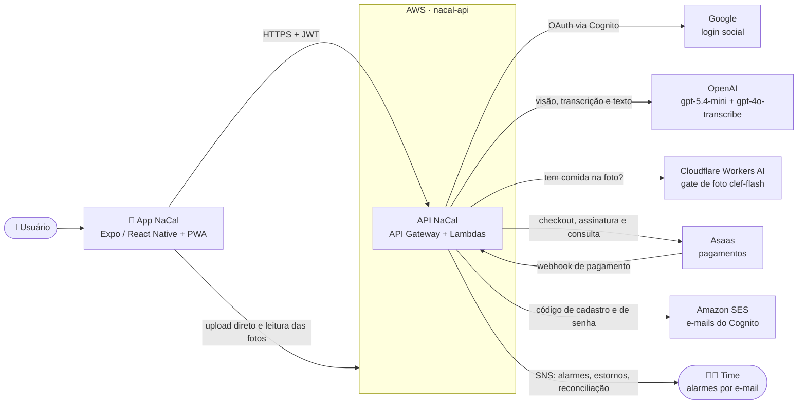
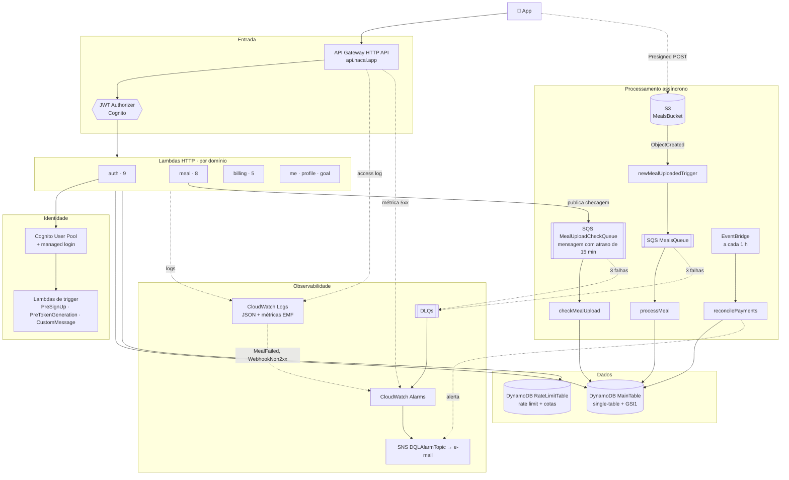

# 01 · Visão geral

A API do NaCal é um backend **serverless e orientado a eventos** na AWS (`sa-east-1`), escrito em TypeScript e implantado com o Serverless Framework v4. O usuário registra refeições por **foto, áudio ou texto**, a IA identifica os alimentos e calcula os macros, e a API guarda tudo e controla as metas, as cotas e o plano pago.

## Contexto: com quem a API conversa

| Sistema externo | Para quê | Onde no código |
|---|---|---|
| **OpenAI** | Identificar alimentos na foto, transcrever áudio e interpretar texto | `src/infra/ai/gateways/MealAiGateway.ts` |
| **Cloudflare Workers AI** | Gate barato que rejeita foto sem comida antes da OpenAI (falha aberta: se cair, a foto segue) | `src/infra/ai/gateways/MealGateGateway.ts` |
| **Google** | Login social, via Cognito (o Google não é chamado direto) | `sls/resources/userPool.yaml` |
| **Asaas** | Cobrança do plano Pro (checkout, assinatura e webhook) | `src/infra/gateways/AsaasPaymentGateway.ts` |
| **SES** | O Cognito manda os e-mails de código pelo SES, com o HTML que a API monta | `src/infra/emails/` |

## Containers: as peças da AWS

Pontos que valem guardar:

- **O arquivo nunca passa pela Lambda na subida.** A API devolve um Presigned POST e o app manda o arquivo direto para o S3. A Lambda só lê o arquivo depois, já no processamento.
- **O arquivo não sai do S3 para o app.** Não há CDN e a API não devolve URL do arquivo (a CloudFront foi removida em 2026-11-17: o app nunca mostrou a foto). O `processMeal` lê o arquivo do S3, valida e manda o mesmo buffer para a OpenAI (base64 na foto). O bucket não é público. Se o app passar a mostrar a foto, o caminho previsto é uma URL pré-assinada de `GetObject` com validade curta, gerada pela API a cada resposta.
- **Duas tabelas.** `MainTable` guarda as entidades. `RateLimitTable` guarda contadores atômicos: rate limit por IP, conta, e-mail ou hash do token, as **cotas de refeição**, o teto diário de rejeições estornadas e a idempotência do webhook. As duas usam TTL (`expiresAt`).
- **Toda fila tem DLQ e alarme.** Os alarmes só disparam em prod (`IsProd`) e caem no tópico SNS, que manda e-mail. Além das filas, há alarmes de `5xx` do HTTP API, de resposta não-2xx do webhook do Asaas, de refeição `FAILED` e de throttling da `processMeal` (ver [operação](06-operacao.md#alarmes)).
- **Logs em JSON.** Uma linha por evento, com retenção de 30 dias; as métricas `MealFailed` e `WebhookNon2xx` saem das próprias linhas (EMF), sem metric filter.

## Inventário de Lambdas

São 32 Lambdas, definidas em `sls/functions/*.yml`. O handler de cada uma é um arquivo em `src/main/functions/` que só liga um **adapter** a uma classe da aplicação (detalhes em [02 · Arquitetura do código](02-arquitetura-codigo.md)).

### Disparadas por HTTP

🔒 = exige JWT do Cognito (`CognitoAuthorizer`).

| Domínio | Método e rota | Lambda |
|---|---|---|
| Auth | `POST /auth/sign-up` | `signUp` |
| Auth | `POST /auth/confirm-sign-up` | `confirmSignUp` |
| Auth | `POST /auth/resend-confirmation-code` | `resendConfirmationCode` |
| Auth | `POST /auth/sign-in` | `signIn` |
| Auth | `POST /auth/refresh-token` | `refreshToken` |
| Auth | `POST /auth/forgot-password` | `forgotPassword` |
| Auth | `POST /auth/confirmation-forgot-password` | `confirmationForgotPassword` |
| Auth | `POST /auth/oauth/callback` | `oauthCallback` |
| Auth | `POST /auth/complete-onboarding` | `completeOnboarding` |
| Conta | 🔒 `GET /me` | `me` |
| Perfil | 🔒 `PUT /profiles` | `updateProfile` |
| Meta | 🔒 `POST /goals` | `updateGoal` |
| Refeição | 🔒 `POST /create-meal` | `createMeal` |
| Refeição | 🔒 `POST /meals/text` | `createTextMeal` |
| Refeição | 🔒 `GET /meals` | `listMeal` |
| Refeição | 🔒 `GET /meals/{id}` | `getMealById` |
| Refeição | 🔒 `DELETE /meals/{id}` | `deleteMeal` |
| Refeição | 🔒 `POST /meals/{id}/items` | `addMealItems` |
| Refeição | 🔒 `DELETE /meals/{id}/items/{itemId}` | `removeMealItem` |
| Refeição | 🔒 `POST /meals/{id}/items/{itemId}/restore` | `restoreMealItem` |
| Billing | 🔒 `GET /billing/plans` | `plans` |
| Billing | 🔒 `POST /billing/trial` | `trial` |
| Billing | 🔒 `POST /billing/checkout` | `checkout` |
| Billing | 🔒 `POST /billing/cancel` | `cancel` |
| Billing | `POST /billing/webhooks/asaas` | `webhookAsaas` (token + allowlist de IP, `reservedConcurrency: 5`) |

`complete-onboarding` não usa o authorizer do API Gateway: ele recebe o access token no corpo e valida por conta própria, porque roda antes de a conta estar pronta.

### Disparadas por evento

| Lambda | Gatilho | O que faz | Fluxo |
|---|---|---|---|
| `newMealUploadedTrigger` | S3 `ObjectCreated` no `MealsBucket` | Marca a refeição como `QUEUED` e publica na `MealsQueue` | [Foto/áudio](fluxos/refeicao-foto-audio.md) |
| `processMeal` | SQS `MealsQueue` (lote 2 com retorno parcial, até 5 execuções ao mesmo tempo, timeout 120 s) | Valida o arquivo, roda o gate e a IA e grava o resultado | [Foto/áudio](fluxos/refeicao-foto-audio.md) |
| `checkMealUpload` | SQS `MealUploadCheckQueue` (lote 10 com retorno parcial, atraso de 15 min por mensagem, definido no código) | Falha e estorna a refeição que travou antes do processamento | [Foto/áudio](fluxos/refeicao-foto-audio.md#refeição-presa-checagem-de-15-min) |
| `reconcilePayments` | EventBridge `rate(1 hour)`, só com o Asaas de produção | Confere pagamentos no Asaas e corrige assinaturas que o webhook perdeu | [Reconciliação](fluxos/billing-reconciliacao.md) |
| `preSignUpTrigger` | Cognito `PreSignUp` | Aplica o beta fechado e cria o usuário "shadow" do login com Google | [Login com Google](fluxos/auth-google-oauth.md) |
| `preTokenGenerationTrigger` | Cognito `PreTokenGeneration` V2 | Injeta o claim `internalId` no token | [Login com Google](fluxos/auth-google-oauth.md) |
| `customMessageTrigger` | Cognito `CustomMessage` | Troca o texto dos e-mails de código pelo HTML do NaCal | [Cadastro](fluxos/auth-cadastro-email.md) |

## Stack e convenções

| Item | Valor |
|---|---|
| Runtime | Node.js 24, arm64 |
| Memória e timeout | Padrão: 256 MB (`provider.memorySize`) e 6 s (padrão do Serverless, sem `timeout` no provider). Exceções na tabela abaixo. |
| Build | esbuild, um pacote por Lambda (`package.individually: true`) |
| Validação | zod v4 (`zod/mini`) |
| Package manager | `yarn` |
| Ambientes | `dev` (conta pessoal) e `prod` (conta `nacal-prod`) |
| Testes | Não há suíte automatizada. Só `yarn typecheck` e `npx eslint .` |

| Lambda | Memória | Timeout |
|---|---|---|
| `processMeal` | 1024 MB | 120 s |
| `me`, `createMeal`, `getMealById`, `listMeal`, `signIn`, `refreshToken` | 512 MB | 6 s |
| `createTextMeal`, `addMealItems` | 256 MB | 29 s |
| `reconcilePayments` | 256 MB | 60 s, sem retry automático (`maximumRetryAttempts: 0`) |
| `checkout` | 256 MB | 29 s |
| `cancel`, `webhookAsaas`, `oauthCallback`, `checkMealUpload` | 256 MB | 15 s |
| Todas as outras | 256 MB | 6 s |

Até 2026-11-17 o padrão era 128 MB. As funções HTTP usavam de 97 a 121 MB (`checkout`, `oauthCallback` e `reconcilePayments` chegavam a 121 MB), perto de estourar a memória, e com 128 MB a Lambda recebe pouca CPU: Init Duration p50 de 258 a 313 ms e p90 da duração acima de 1,2 s nas 6 rotas mais usadas. Por isso o padrão subiu para 256 MB e as 6 rotas mais chamadas pelo app foram para 512 MB. Medido em dev depois da mudança: o Init Duration não muda (255–325 ms, porque a fase de init recebe CPU independente da memória), mas a duração da primeira request depois do cold start caiu de 1,0–2,1 s para 0,3–0,7 s (p50: `createMeal` 2,1 → 0,55 s, `signIn` 2,0 → 0,7 s, `refreshToken` 1,7 → 0,6 s, `me` 1,4 → 0,46 s, `getMealById` 1,25 → 0,32 s, `listMeal` 1,0 → 0,34 s). O custo fica abaixo de US$ 0,01 por mês no volume atual de prod. Para conferir, use a consulta de `REPORT` em [06-operacao.md](06-operacao.md).

Os timeouts de `checkout` e `cancel` ficam acima do abort de 10 s de cada chamada ao Asaas: o `checkout` pode fazer duas chamadas seguidas (cancelar a assinatura antiga e criar o checkout) e fica logo abaixo do corte de 30 s do HTTP API. O `oauthCallback` cobre o abort de 5 s da troca do `code` mais a validação do JWT, o `AdminGetUser` e a conta no DynamoDB (ver [billing](fluxos/billing.md#erros) e [login com Google](fluxos/auth-google-oauth.md#erros)).
