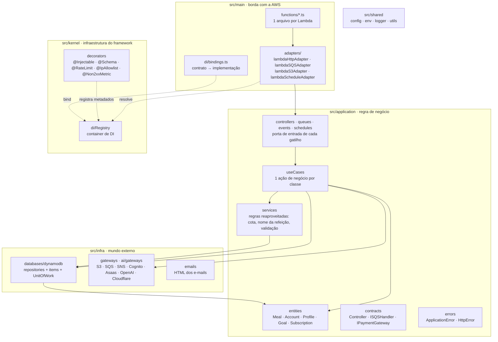
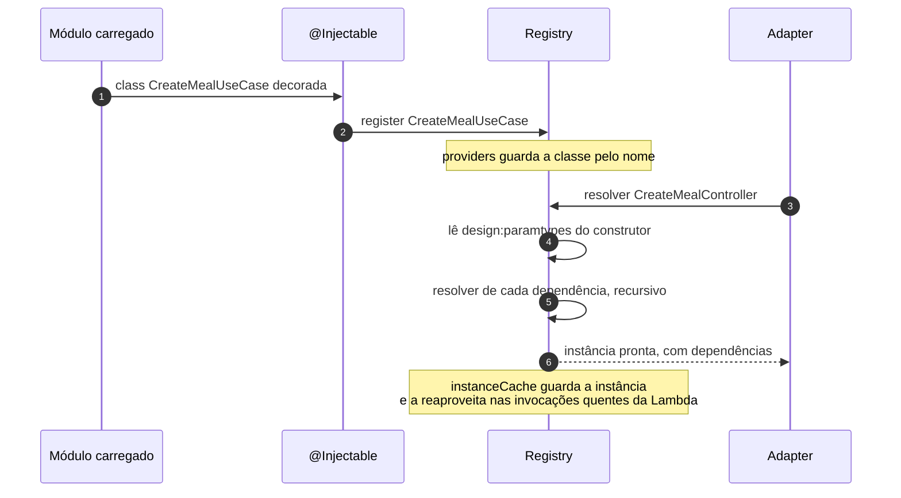
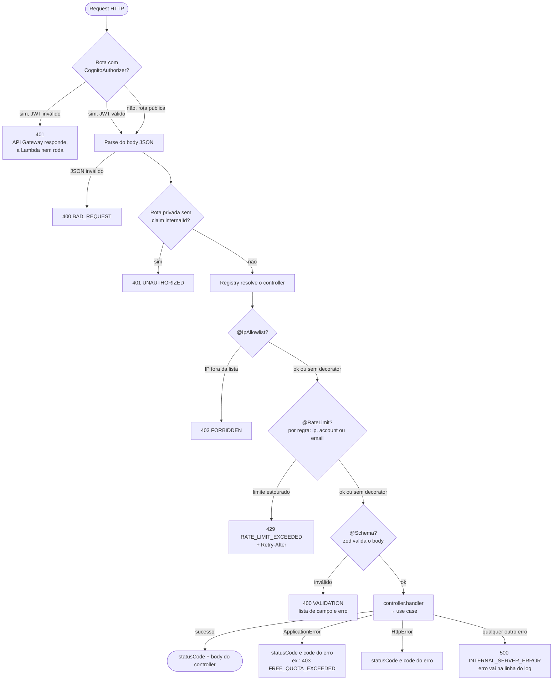

# 02 · Arquitetura do código

O código segue uma arquitetura em camadas, com **injeção de dependência por decorators**. A regra de negócio fica nos use cases e entidades e não conhece a Lambda: a Lambda só entra pelos adapters em `src/main/`.

## Camadas



| Camada | Pasta | Responsabilidade | Pode depender de |
|---|---|---|---|
| **main** | `src/main/` | Recebe o evento da AWS, resolve a classe pelo DI, converte o resultado ou o erro em resposta e loga cada evento | application, kernel, shared |
| **application** | `src/application/` | Controllers, use cases, services, entidades, erros e contratos | infra, kernel, shared |
| **infra** | `src/infra/` | Repositórios do DynamoDB e gateways dos serviços externos | application (entidades, erros, contratos e alguns services), kernel, shared |
| **kernel** | `src/kernel/` | Container de DI e decorators | nada do projeto |
| **shared** | `src/shared/` | `AppConfig`, validação das variáveis de ambiente, logger JSON e utilitários | nada do projeto |

Os imports usam aliases: `@application/*`, `@infra/*`, `@kernel/*`, `@main/*`, `@shared/*`.

### Mapa das pastas

```text
src/
├── kernel/
│   ├── decorators/        @Injectable, @Schema, @RateLimit, @IpAllowlist, @Non2xxMetric
│   └── di/                Registry (container de DI)
├── shared/
│   ├── config/            AppConfig, validação do env, beta, termos
│   ├── logger/            logger JSON e métricas EMF
│   └── utils/             fuso, IDs, e-mail normalizado, duração de WebM
├── main/
│   ├── adapters/          HTTP, SQS, S3 e schedule
│   ├── di/                bindings de contrato → implementação
│   ├── utils/             parse do body e montagem das respostas
│   └── functions/         1 handler por Lambda, por domínio
├── application/
│   ├── contracts/         Controller, ISQSHandler, IEventHandler, IScheduleHandler, IPaymentGateway
│   ├── controllers/       controllers HTTP + schemas zod
│   ├── queues/            consumidores SQS
│   ├── events/            handler do evento do S3
│   ├── schedules/         handler da reconciliação
│   ├── useCases/          ações de negócio, por domínio
│   ├── services/          cota, rate limit, nome da refeição, validação de arquivo, edição de itens, meta, provisionamento de conta
│   ├── entities/          Account, Profile, Goal, Meal, Subscription, PendingSignUp
│   ├── presenters/        formato de saída da refeição
│   ├── query/             leituras diretas no DynamoDB
│   └── errors/            ErrorCode, ApplicationError, HttpError, MealRejectedError
└── infra/
    ├── clients/           clients do AWS SDK
    ├── databases/dynamodb repositórios, items (entidade ↔ item), Unit of Work e utils (update condicional)
    ├── gateways/          Cognito, S3, SQS, SNS, Asaas
    ├── ai/                gateways da OpenAI e da Cloudflare + prompts
    ├── emails/            layout e templates dos e-mails
    └── utils/             download por URL
```

> **Na prática, os use cases dependem das classes concretas de infra** (`MealRepository`, `MealFileStorageGateway`). A única inversão com contrato abstrato é o gateway de pagamento: `IPaymentGateway` é ligado ao `AsaasPaymentGateway` em `src/main/di/bindings.ts`, para dar para trocar de gateway sem mexer nos use cases.

## Injeção de dependência

O container é um singleton simples (`src/kernel/di/Registry.ts`) que lê os tipos do construtor via `reflect-metadata`.



Regras para não se perder:

- **Toda classe resolvida pelo DI precisa de `@Injectable()`**, senão o erro é `X is not registered.`
- **Todo handler em `src/main/functions/` começa com `import 'reflect-metadata'`**. Sem esse import, o `Registry` não consegue ler os tipos do construtor em runtime e não sabe quais dependências injetar.
- **As instâncias são singletons por Lambda.** Elas sobrevivem entre invocações quentes, então não guarde estado de request em campo da classe.
- Os handlers das Lambdas que usam `IPaymentGateway` (as de billing) também importam `@main/di/bindings`.

## Os quatro adapters

Cada tipo de gatilho tem um adapter, e cada adapter espera um contrato:

| Adapter | Gatilho | Contrato da classe | Comportamento em erro |
|---|---|---|---|
| `lambdaHttpAdapter` | API Gateway HTTP | `Controller<'public' \| 'private'>` | Converte em resposta HTTP. Nunca lança. |
| `lambdaSQSAdapter` | SQS | `ISQSHandler` | Processa o lote com `Promise.allSettled`, registra cada erro no log e devolve `batchItemFailures`: só as mensagens que falharam voltam para a fila. O evento precisa de `functionResponseType: ReportBatchItemFailures`. |
| `lambdaS3Adapter` | S3 | `IEventHandler` | Só registra no log (`Promise.allSettled`). Não há retry. |
| `lambdaScheduleAdapter` | EventBridge | `IScheduleHandler` | Lança. |

Os triggers do Cognito (`preSignUpTrigger`, `preTokenGenerationTrigger`, `customMessageTrigger`) são a exceção: são handlers escritos direto, sem adapter nem DI.

O handler de uma Lambda inteira cabe em três linhas:

```ts
import 'reflect-metadata';
import { CreateMealController } from '@application/controllers/meal/CreateMealController';
import { lambdaHttpAdapter } from '@main/adapters/lambdaHttpAdapter';

export const handler = lambdaHttpAdapter(CreateMealController);
```

## Ciclo de vida de uma request HTTP

O que acontece entre o API Gateway e a resposta, em `src/main/adapters/lambdaHttpAdapter.ts` e `src/application/contracts/Controller.ts`:



Todo erro sai no mesmo formato:

```json
{
  "error": {
    "code": "FREE_QUOTA_EXCEEDED",
    "message": "Free quota exceeded."
  }
}
```

Toda request termina numa linha JSON `http request` (nível `INFO` para 2xx e 3xx, `WARN` para 4xx e `ERROR` para 5xx) com `awsRequestId`, `routeKey`, `accountId` (rotas 🔒), `statusCode`, `durationMs` e `errorCode`. Nos `500` e nos `ApplicationError` 5xx (ex.: `502 BILLING_ERROR`), a mesma linha leva o `error` serializado (nome, mensagem, stack e `cause`). Um controller com `@Non2xxMetric('<métrica>')` também emite essa métrica EMF quando a resposta não é 2xx, incluindo o `403` da allowlist e o `429` do rate limit (hoje só o webhook do Asaas, com `WebhookNon2xx`).

Os códigos ficam em `src/application/errors/ErrorCode.ts`. Para um erro de negócio novo, adicione o `code` em `ErrorCode.ts` (o tipo só aceita códigos que estão lá) e crie uma classe em `src/application/errors/application/` estendendo `ApplicationError` com `statusCode` e `code`. O adapter já sabe convertê-la.

### Logger

`src/shared/logger/logger.ts` escreve uma linha JSON por evento direto no `stdout` (sem o prefixo do `console`, para o CloudWatch ler como JSON e extrair as métricas EMF). Use `logger.info`, `logger.warn` e `logger.error` com uma mensagem curta e fixa e os dados num objeto: `logger.error('asaas request failed', { path, error })`. Um `Error` em qualquer campo é serializado com nome, mensagem, stack e `cause`. Os adapters abrem um contexto por evento (`awsRequestId`, mais `routeKey`/`accountId` no HTTP, `messageId`/`receiveCount` no SQS e `fileKey` no S3) que entra em toda linha logada dentro dele; `logger.appendContext({ mealId })` acrescenta campos ao contexto atual. `logger.metric('MealFailed', { ... })` grava uma linha que também é uma métrica EMF (namespace `NaCal`, dimensão `Service` = `nacal-api-<stage>`). Não use `console.*` no código da API.

### Um controller completo

Os decorators declaram o que o adapter tem que checar antes de chamar o `handler`:

```ts
@Injectable()
@Schema(createMealSchema)
@RateLimit({ scope: 'account', limit: 10, windowSeconds: 3600 })
export class CreateMealController extends Controller<'private'> {
  constructor(private readonly createMealUseCase: CreateMealUseCase) {
    super();
  }

  protected async handler(request: Controller.RequestPrivate<CreateMealBody>) {
    // request.accountId já vem do JWT, request.body já vem validado
  }
}
```

`Controller<'private'>` garante no tipo que `request.accountId` existe. Em `Controller<'public'>` ele não existe.

## Receita: adicionar um endpoint

1. **Schema**: `src/application/controllers/<domínio>/schemas/<nome>Schema.ts` com `zod/mini`.
2. **Use case**: `src/application/useCases/<domínio>/<Nome>UseCase.ts`, com `@Injectable()` e as dependências no construtor.
3. **Controller**: `src/application/controllers/<domínio>/<Nome>Controller.ts`, com `@Injectable()`, `@Schema(...)` e, se for o caso, `@RateLimit(...)`.
4. **Handler**: `src/main/functions/<domínio>/<nome>.ts` com `lambdaHttpAdapter(<Nome>Controller)`.
5. **Rota**: entrada em `sls/functions/<domínio>.yml` (o de `auth` usa `.yaml`), com `authorizer: name: CognitoAuthorizer` se for privada. Um domínio novo também precisa entrar em `functions:` no `serverless.yml`.
6. **Permissões e segredos**: cada função tem o próprio papel IAM. Liste em `iam.role.statements` os trechos de `sls/iam/statements.yml` que ela usa, e ponha no `environment` dela só os segredos que ela lê. Se o use case reaproveita um serviço que passou a chamar algo novo da AWS, as outras funções que usam esse serviço também precisam do trecho. Detalhes em [Operação](06-operacao.md#permissões-e-segredos-por-função).
7. **Docs**: atualize o README da API e, se o fluxo mudou, o diagrama correspondente neste guia.
8. **Checagem**: `yarn typecheck` e `npx eslint .`.

Para um consumidor de fila, troque o controller por uma classe em `src/application/queues/` que implementa `ISQSHandler`, e o adapter por `lambdaSQSAdapter`.
