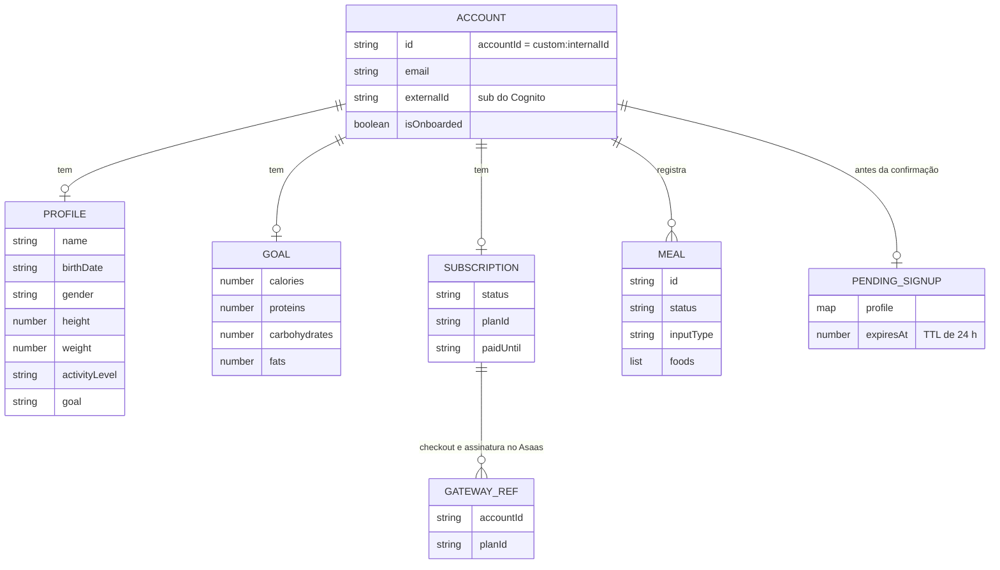

# 03 · Modelo de dados

A API usa **duas tabelas do DynamoDB**, as duas `PAY_PER_REQUEST` e com TTL no atributo `expiresAt`:

| Tabela | O que guarda | Extras |
|---|---|---|
| `nacal-api-<stage>-MainTable` | Entidades do domínio, em **single-table** | GSI `GSI1`, point-in-time recovery ligado |
| `nacal-api-<stage>-RateLimitTable` | Contadores: rate limit, cotas de refeição e idempotência de eventos | — |

Separar os contadores deixa a tabela principal só com dados de negócio e evita que o tráfego de rate limit concorra com ela.

A página segue o formato de modelagem do NoSQL Workbench:

1. [Entidades](#entidades): o diagrama de relacionamento.
2. [Access patterns](#access-patterns): cada consulta e cada escrita que a API faz, com a chave usada.
3. [Item collections](#item-collections): os itens de cada partição, com chaves e atributos.

Convenções: `<accountId>` é um valor, `#` é o separador literal dentro da chave. Datas são gravadas como **string ISO 8601** (`2026-11-13T15:04:05.000Z`) e TTLs como **epoch em segundos** (`number`).

## Entidades

Os atributos completos de cada entidade estão em [item collections](#item-collections).

## Access patterns

### Leituras

| # | Access pattern | Índice | Chave | Operação | Onde |
|---|---|---|---|---|---|
| AP01 | Buscar conta pelo id | Tabela | `PK = ACCOUNT#<accountId>`, `SK = ACCOUNT#<accountId>` | `GetItem` consistente | `AccountsRepository.findById` |
| AP02 | Buscar conta pelo e-mail | `GSI1` | `GSI1PK = ACCOUNT#<email>`, `GSI1SK = ACCOUNT#<email>` | `Query`, `Limit 1` | `AccountsRepository.findByEmail` |
| AP03 | Conta + perfil + meta + assinatura de uma vez | Tabela | `PK = ACCOUNT#<accountId>`, `begins_with(SK, ACCOUNT#<accountId>)` | `Query`, `Limit 5` | `GetProfileAndGoalByAccountId` (`GET /me`) |
| AP04 | Buscar perfil | Tabela | `PK = ACCOUNT#<accountId>`, `SK = ACCOUNT#<accountId>#PROFILE` | `GetItem` | `ProfileRepository.findByAccountId` |
| AP05 | Buscar meta | Tabela | `PK = ACCOUNT#<accountId>`, `SK = ACCOUNT#<accountId>#GOAL` | `GetItem` | `GoalRepository.findByAccountId` |
| AP06 | Buscar assinatura | Tabela | `PK = ACCOUNT#<accountId>`, `SK = ACCOUNT#<accountId>#SUBSCRIPTION` | `GetItem` | `SubscriptionRepository.findByAccountId` |
| AP07 | Listar refeições do dia, da mais nova para a mais antiga | `GSI1` | `GSI1PK = MEAL#<accountId>#<AAAA-MM-DD>` + filtro `status = SUCCESS` | `Query`, `ScanIndexForward false` | `ListMealsByAccountIdAndDay` |
| AP08 | Buscar refeição pelo id | Tabela | `PK = ACCOUNT#<accountId>MEAL#<mealId>`, `SK = MEAL#<mealId>` | `GetItem`. Consistente no polling, em remover e restaurar e na checagem de 15 min. Eventual em adicionar itens e excluir | `MealRepository.findById` |
| AP09 | Buscar cadastro pendente | Tabela | `PK = SK = PENDING_SIGNUP#<accountId>` | `GetItem` consistente | `PendingSignUpRepository.findByAccountId` |
| AP10 | Achar a conta de um ID do Asaas | Tabela | `PK = SK = GATEWAY#<checkoutId ou subscriptionId>` | `GetItem` | `SubscriptionRepository.findGatewayRef` |
| AP11 | Ler o uso da cota | `RateLimitTable` | `PK = RL#account-monthly#<accountId>` ou `RL#account-daily#<accountId>`, `SK = <bucket>` | `GetItem` | `RateLimitRepository.getQuotaCount` |
| AP12 | Evento de webhook já processado? | `RateLimitTable` | `PK = RL#webhook-event#<eventId>`, `SK = EVENT` | `GetItem` | `RateLimitRepository.hasWebhookEvent` |

`AP07` sai em ordem de criação porque o `mealId` (no `GSI1SK`) é um KSUID, ordenável pelo tempo. `AP07` usa o dia **local** do usuário, calculado do `createdAt` com o `timeZone` gravado na refeição: um jantar às 23h em São Paulo cai no mesmo dia do café da manhã.

### Escritas

Quase toda escrita é condicional. A condição é o que garante a regra de negócio quando há retry, mensagem duplicada ou requests simultâneas.

| # | Escrita | Operação | Condição | Onde |
|---|---|---|---|---|
| AW01 | Criar conta completa (Account + Profile + Goal) | `TransactWriteItems` com 3 `Put` | — | `SignUpUOW` |
| AW02 | Criar conta sem onboarding | `PutItem` | — | `AccountsRepository.create` |
| AW03 | Editar perfil ou meta | `UpdateItem` | `attribute_exists(PK)` | `ProfileRepository.save`, `GoalRepository.save` |
| AW04 | Criar cadastro pendente / apagar | `PutItem` / `DeleteItem` | — | `PendingSignUpRepository` |
| AW05 | Criar assinatura (trial ou primeiro pagamento) | `PutItem` | `attribute_not_exists(SK)`: só se nunca existiu | `SubscriptionRepository.create` |
| AW06 | Atualizar assinatura | `PutItem` do item inteiro | — (duas escritas ao mesmo tempo, ex.: cancelamento e webhook, podem perder a atualização uma da outra) | `SubscriptionRepository.save` |
| AW07 | Ligar ID do Asaas à conta | `PutItem` | — | `SubscriptionRepository.linkGatewayRef` |
| AW08 | Criar refeição | `PutItem` | — | `MealRepository.create` |
| AW09 | Refeição `UPLOADING` → `QUEUED` | `UpdateItem` | `status IN (UPLOADING, QUEUED)` | `markQueued` |
| AW10 | Reivindicar a refeição para processar | `UpdateItem`, `ADD attempts 1` | `QUEUED`, ou `PROCESSING` com lease vencido, e `attempts < 2` | `claimForProcessing` |
| AW11 | Devolver para a fila | `UpdateItem` | `PROCESSING` com o mesmo `leaseExpiresAt` | `markForRetry` |
| AW12 | Gravar o resultado da IA | `UpdateItem` | `status = PROCESSING` | `markSuccess` |
| AW13 | Rejeitar ou falhar **e estornar a cota** | `TransactWriteItems` nas duas tabelas, com `ClientRequestToken` | Rejeitar: `status = PROCESSING`. Falhar: status, `attempts` e lease lidos. Mais o contador `> 0`: se essa parte falhar, grava o status sem estorno (`quotaRefunded: false`) | `rejectAndRefund`, `failAndRefund` |
| AW14 | Adicionar itens | `UpdateItem`, `list_append` | `SUCCESS`, menos de 5 adições, cabe nos 30 itens, dentro das 24 h | `appendFoods` |
| AW15 | Remover ou restaurar item | `UpdateItem` | `SUCCESS` e `foodsVersion` igual ao lido | `saveFoods` |
| AW16 | Excluir refeição | `UpdateItem` para `DELETED` | `status IN (SUCCESS, REJECTED, FAILED)` | `markDeleted` |
| AW17 | Consumir cota ou rate limit | `UpdateItem`, `ADD count 1` | `count < limite` | `RateLimitRepository.increment`, `incrementQuotaCounter` |
| AW18 | Estornar cota | `UpdateItem`, `ADD count -1` | `count > 0` | `decrementQuotaCounter` |
| AW19 | Marcar evento de webhook | `PutItem` com TTL | — | `markWebhookEvent` |

## Item collections

Uma item collection é o conjunto de itens que dividem a mesma `PK`. O atributo `type` diz qual entidade cada item representa.

### Collection da conta

`PK = ACCOUNT#<accountId>`. Quatro itens na mesma partição, lidos de uma vez pelo `AP03`.

| `PK` | `SK` | `GSI1PK` | `GSI1SK` | `type` |
|---|---|---|---|---|
| `ACCOUNT#<accountId>` | `ACCOUNT#<accountId>` | `ACCOUNT#<email>` | `ACCOUNT#<email>` | `ACCOUNT` |
| `ACCOUNT#<accountId>` | `ACCOUNT#<accountId>#PROFILE` | — | — | `PROFILE` |
| `ACCOUNT#<accountId>` | `ACCOUNT#<accountId>#GOAL` | — | — | `GOAL` |
| `ACCOUNT#<accountId>` | `ACCOUNT#<accountId>#SUBSCRIPTION` | — | — | `SUBSCRIPTION` |

**`ACCOUNT`**

| Atributo | Tipo | Observação |
|---|---|---|
| `id` | string | É o `accountId` e o `custom:internalId` do Cognito |
| `email` | string | Sempre em minúsculas |
| `externalId` | string | `sub` do usuário no Cognito |
| `isOnboarded` | boolean | `false` até existirem perfil e meta |
| `termsVersion` | string \| null | Versão dos termos aceitos |
| `termsAcceptedAt` | string (data) \| null | |
| `createdAt` | string (data) | |

**`PROFILE`**

| Atributo | Tipo | Observação |
|---|---|---|
| `accountId` | string | |
| `name` | string | |
| `birthDate` | string (data) | |
| `gender` | enum | `MALE`, `FEMALE` |
| `height` | number | Em cm |
| `weight` | number | Em kg |
| `activityLevel` | enum | `SENDENTARY`, `LIGHT`, `MODERATE`, `HEAVY`, `ATHELETE` (grafia do código) |
| `goal` | enum | `LOSE`, `MAINTAIN`, `GAIN` |
| `createdAt` | string (data) | |

**`GOAL`**

| Atributo | Tipo | Observação |
|---|---|---|
| `accountId` | string | |
| `calories` | number | kcal por dia |
| `proteins` | number | g por dia |
| `carbohydrates` | number | g por dia |
| `fats` | number | g por dia |
| `createdAt` | string (data) | |

**`SUBSCRIPTION`**

| Atributo | Tipo | Observação |
|---|---|---|
| `accountId` | string | |
| `gateway` | enum | `ASAAS` |
| `status` | enum | `TRIALING`, `ACTIVE`, `PAST_DUE`, `CANCELED`, `EXPIRED` (este nunca é gravado hoje) |
| `planId` | enum | `PRO_MONTHLY`, `PRO_YEARLY` |
| `gatewayRefs` | map, opcional | `{ customerId?, subscriptionId?, checkoutId? }` no tipo, mas hoje só `subscriptionId` é gravado. O checkout fica no item `GATEWAY#` |
| `trialStartedAt` | string (data) | |
| `trialEndsAt` | string (data), opcional | |
| `paidUntil` | string (data), opcional | Junto com o status, decide se é Pro |
| `canceledAt` | string (data), opcional | |
| `createdAt` | string (data) | |

### Collection da refeição

`PK = ACCOUNT#<accountId>MEAL#<mealId>`. **Uma partição por refeição**, com um item só. A listagem do dia vem pelo `GSI1`.

| `PK` | `SK` | `GSI1PK` | `GSI1SK` | `type` |
|---|---|---|---|---|
| `ACCOUNT#<accountId>MEAL#<mealId>` | `MEAL#<mealId>` | `MEAL#<accountId>#<AAAA-MM-DD>` | `MEAL#<mealId>` | `MEAL` |

> A `PK` não tem `#` entre o `accountId` e `MEAL`. Está assim nos dados gravados, então mudar exige migração.

| Atributo | Tipo | Observação |
|---|---|---|
| `id` | string | |
| `accountId` | string | |
| `status` | enum | `UPLOADING`, `QUEUED`, `PROCESSING`, `SUCCESS`, `REJECTED`, `FAILED`, `DELETED` |
| `inputType` | enum | `PICTURE`, `AUDIO`, `TEXT` |
| `inputFileKey` | string \| null | Chave no S3. `null` na refeição por texto |
| `timeZone` | string, opcional | IANA, define o dia local e o nome |
| `description` | string \| null | Nota da foto ou o texto da refeição por texto |
| `name` | string | Ex.: "Almoço" |
| `icon` | string | Emoji |
| `foods` | list de map | Itens atuais (ver abaixo) |
| `removedFoods` | list de map | Itens removidos, com `removedAt`, para restaurar |
| `attempts` | number | Tentativas de processamento (máx. 2) |
| `leaseExpiresAt` | number \| null | Epoch em segundos da reserva de processamento |
| `rejectionReason` | enum \| null | `INVALID_FILE`, `NOT_A_MEAL`, `NO_FOOD_DETECTED` |
| `gateScore` | number \| null | Score do gate da Cloudflare (0 a 1) |
| `unidentified` | enum \| null | `DRINK`, `PACKAGED`, `COVERED`, `OTHER` |
| `quotaMonth` | string \| null | Bucket mensal consumido (`AAAA-MM` ou `AAAA-MM#PRO`) |
| `quotaDay` | string \| null | Bucket diário consumido (só Pro) |
| `quotaRefunded` | boolean | Se a cota foi estornada |
| `itemAdditions` | number | Quantas vezes o usuário adicionou itens (máx. 5) |
| `foodsVersion` | number | Versão para a concorrência otimista das edições |
| `createdAt` | string (data) | |
| `rejectedAt`, `editedAt`, `deletedAt` | string (data) \| null | |

Cada item de `foods`:

| Campo | Tipo | Observação |
|---|---|---|
| `id` | string | Refeições antigas podem não ter. A API completa com `f<índice>` na leitura |
| `order` | number | Posição, mantida ao remover e restaurar |
| `name` | string | |
| `quantity` | string | Ex.: "2 colheres de sopa" |
| `calories` | number | Calculado pela API a partir dos macros |
| `proteins`, `carbohydrates`, `fats` | number | Em gramas |
| `source` | enum, opcional | `INITIAL` (da IA na criação) ou `ADDED` (adicionado depois) |

### Collection do cadastro pendente

`PK = SK = PENDING_SIGNUP#<accountId>`. Existe entre o `sign-up` e a confirmação, e o TTL apaga em 24 h.

| Atributo | Tipo | Observação |
|---|---|---|
| `accountId` | string | |
| `email` | string | |
| `externalId` | string | |
| `profile` | map | `{ name, birthDate, gender, height, weight, activityLevel, goal }`, os mesmos tipos do `PROFILE` |
| `termsVersion` | string | |
| `termsAcceptedAt` | string (data) | |
| `createdAt` | string (data) | |
| `expiresAt` | number | TTL |
| `type` | string | `PENDING_SIGNUP` |

### Collection dos vínculos com o Asaas

`PK = SK = GATEWAY#<id no Asaas>`. Um item por checkout e por assinatura do Asaas, para o webhook achar a conta.

| Atributo | Tipo | Observação |
|---|---|---|
| `accountId` | string | |
| `planId` | enum | `PRO_MONTHLY`, `PRO_YEARLY` |
| `createdAt` | string (data) | |
| `type` | string | `GATEWAY_REF` |

### Collections da `RateLimitTable`

Itens só com `count` e `expiresAt`, sem `type`.

| Uso | `PK` | `SK` | Atributos | TTL |
|---|---|---|---|---|
| Rate limit por janela | `RL#<ip, account ou email>#<rota>#<valor>`, ex.: `RL#ip#POST /auth/sign-in#203.0.113.7`. No escopo e-mail: `RL#email#<rota>#email#<e-mail>` | Início da janela (epoch) | `count`, `expiresAt` | Fim da janela |
| Cota mensal | `RL#account-monthly#<accountId>` | `AAAA-MM` (Free) ou `AAAA-MM#PRO` (Pro) | `count`, `expiresAt` | 7 dias depois do fim do mês |
| Cota diária do Pro | `RL#account-daily#<accountId>` | `AAAA-MM-DD` no fuso de São Paulo | `count`, `expiresAt` | 15 dias |
| Evento de webhook processado | `RL#webhook-event#<eventId>` | `EVENT` | `expiresAt` | 14 dias. Na reconciliação, a janela + 10 dias (45 no padrão de 35) |

## S3 e CDN

| Item | Valor |
|---|---|
| Bucket | `nacal-api-<stage>-meals-bucket` (`DeletionPolicy: Retain`, sobrevive a um `sls remove`) |
| Chave | `<accountId>/<uuid>.<jpeg, m4a ou webm>` |
| Metadados | `x-amz-meta-mealid` e `x-amz-meta-accountid`, obrigatórios no Presigned POST |
| Leitura | Só pela CloudFront, com Origin Access Control |
| Remoção | Quando a refeição é rejeitada, falha ou é excluída |

## Arquivos envolvidos

| Item | Arquivo |
|---|---|
| Definição das tabelas | [`mainTable.yml`](../../sls/resources/mainTable.yml), [`rateLimitTable.yml`](../../sls/resources/rateLimitTable.yml) |
| Conversão entidade ↔ item | [`items/`](../../src/infra/databases/dynamodb/items/) |
| Repositórios | [`databases/dynamodb/`](../../src/infra/databases/dynamodb/) |
| Consultas diretas | [`query/`](../../src/application/query/) |
| Transações | [`UnitOfWork.ts`](../../src/infra/databases/dynamodb/uow/UnitOfWork.ts), [`SignUpUOW.ts`](../../src/infra/databases/dynamodb/uow/SignUpUOW.ts) |
| Bucket e CDN | [`mealsBucket.yml`](../../sls/resources/mealsBucket.yml), [`mealsBucketCDN.yml`](../../sls/resources/mealsBucketCDN.yml) |
