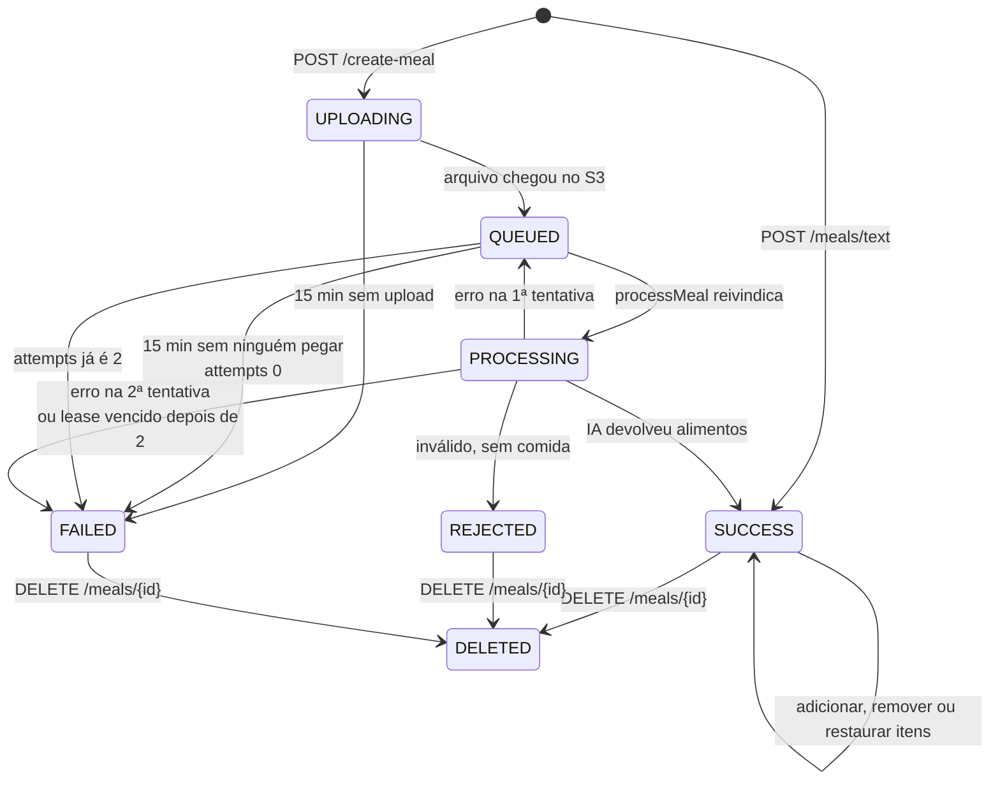
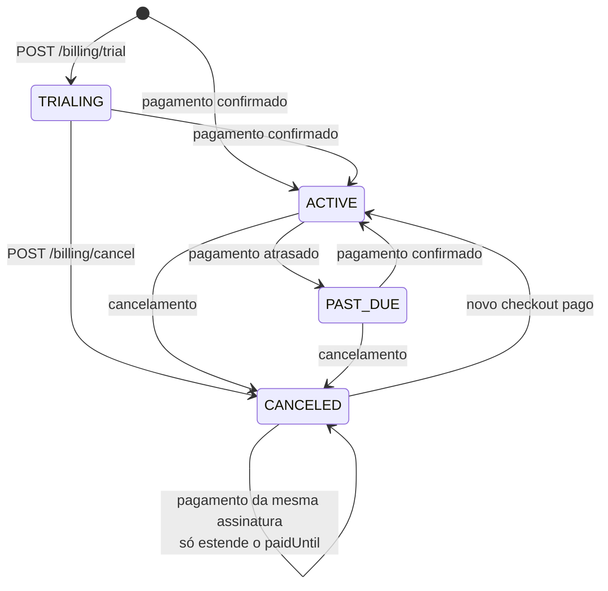
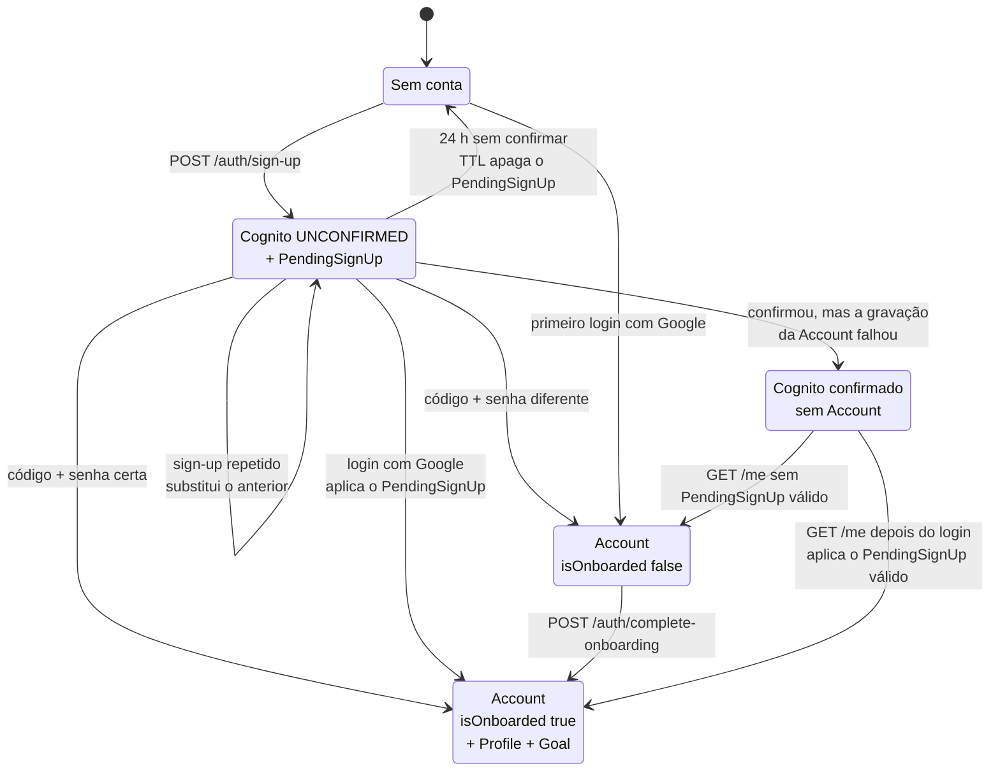

# 04 · Máquinas de estado

Três entidades têm um ciclo de vida que vale entender antes de mexer no código. Todas as transições são gravadas com **escrita condicional** no DynamoDB: a mudança só acontece se o estado gravado ainda for o esperado. É isso que torna os retries, as mensagens duplicadas e as requests simultâneas seguros.

## Refeição

| De → para | Quem faz | Condição gravada |
|---|---|---|
| `UPLOADING` → `QUEUED` | `newMealUploadedTrigger` | status é `UPLOADING` ou `QUEUED` |
| `QUEUED` → `PROCESSING` | `processMeal` | `QUEUED` (ou `PROCESSING` com lease vencido) e `attempts < 2` |
| `PROCESSING` → `SUCCESS` / `REJECTED` | `processMeal` | status é `PROCESSING` |
| `PROCESSING` → `QUEUED` | `processMeal` | `PROCESSING` com o mesmo `leaseExpiresAt` |
| `*` → `FAILED` | `processMeal` ou `checkMealUpload` (só `UPLOADING`, ou `QUEUED` com `attempts = 0`) | o status, o `attempts` e o lease lidos, numa transação com o estorno |
| `SUCCESS` → `SUCCESS` (adicionar itens) | `addMealItems` | `SUCCESS`, menos de 5 adições, cabe nos 30 itens e dentro das 24 h (sem `foodsVersion`) |
| `SUCCESS` → `SUCCESS` (remover ou restaurar) | `removeMealItem`, `restoreMealItem` | `SUCCESS` e `foodsVersion` igual ao lido |
| `*` → `DELETED` | `deleteMeal` | status é `SUCCESS`, `REJECTED` ou `FAILED` |

Detalhes: [refeição por foto ou áudio](fluxos/refeicao-foto-audio.md#estados-da-refeição) e [itens](fluxos/refeicao-itens.md).

## Assinatura

`PAYMENT_OVERDUE` e o cancelamento pelo webhook valem para qualquer status diferente de `CANCELED`, inclusive `TRIALING`.

O status sozinho não diz se o usuário é Pro: `Subscription.resolveEffectivePlan` cruza o status com `trialEndsAt` e `paidUntil` (com 3 dias de carência). Detalhes em [billing](fluxos/billing.md#estados-da-assinatura).

## Conta e onboarding

Toda criação de `Account` passa pelo `AccountProvisioningService`, que é idempotente. Detalhes em [cadastro por e-mail](fluxos/auth-cadastro-email.md) e [login com Google](fluxos/auth-google-oauth.md).

Quando o TTL apaga o `PendingSignUp`, o usuário continua no Cognito como `UNCONFIRMED`. Um novo sign-up com o mesmo e-mail substitui esse usuário.
