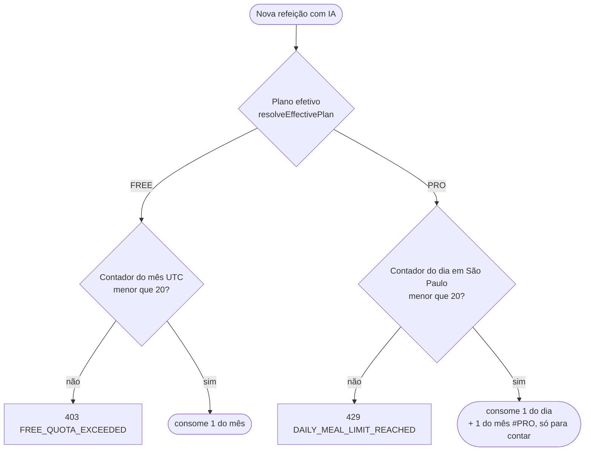

# 05 · Erros, cotas e rate limit

## Formato de erro

Toda resposta de erro tem o mesmo formato (montado pelo `lambdaHttpAdapter`, ver [arquitetura](02-arquitetura-codigo.md#ciclo-de-vida-de-uma-request-http)):

```json
{ "error": { "code": "MEAL_NOT_EDITABLE", "message": "..." } }
```

O app decide o que mostrar pelo `code`, nunca pelo `message`, que é em inglês e pode mudar. Em `VALIDATION`, o `message` é uma lista de `{ field, error }`.

## Catálogo de códigos

| HTTP | `code` | Quando | Rotas |
|---|---|---|---|
| 400 | `VALIDATION` | Corpo fora do schema zod, ou `date` inválida na listagem | Todas com `@Schema`, `GET /meals` |
| 400 | `BAD_REQUEST` | JSON malformado, plano ou `returnUrl` inválido, cancelamento sem assinatura, **qualquer** falha em `confirmation-forgot-password` | Várias |
| 400 | `INVALID_CONFIRMATION_CODE` | Código errado, expirado ou usuário inexistente | `confirm-sign-up` |
| 400 | `INVALID_GRANT` | Troca do `code` OAuth recusada pelo Cognito, ou token inválido ou incompleto | `oauth/callback`, `complete-onboarding`, `GET /me` |
| 401 | `UNAUTHORIZED` | Token válido sem o claim `internalId`, ou access token de um usuário que não existe mais no Cognito | Rotas 🔒; o segundo caso em `GET /me`, `complete-onboarding` e `oauth/callback` |
| 401 | `INVALID_CREDENTIALS` | Senha errada ou usuário inexistente | `sign-in` |
| 401 | `INVALID_REFRESH_TOKEN` | Refresh token inválido, expirado, já usado fora da tolerância de 60 s ou de usuário apagado | `refresh-token` |
| 403 | `FORBIDDEN` | IP fora da allowlist | `webhooks/asaas` |
| 403 | `BETA_ACCESS_DENIED` | E-mail fora do beta fechado | `sign-up` |
| 403 | `EMAIL_NOT_CONFIRMED` | Login antes de confirmar o e-mail | `sign-in` |
| 403 | `FREE_QUOTA_EXCEEDED` | Free sem refeições no mês | `create-meal`, `meals/text`, `meals/{id}/items` |
| 404 | `RESOURCE_NOT_FOUND` | Refeição, item, perfil, meta ou conta não existe | Várias |
| 409 | `EMAIL_ALREADY_IN_USE` | E-mail já tem conta (ou é de outro `internalId`) | `sign-up`, `confirm-sign-up`, `oauth/callback`, `complete-onboarding`, `GET /me` |
| 409 | `EMAIL_LINKED_TO_GOOGLE` | E-mail ligado a uma conta Google: cadastro com e-mail já existente ou senha errada no login | `sign-up`, `sign-in` |
| 409 | `MEAL_NOT_EDITABLE` | Refeição fora de `SUCCESS`, fora da janela de 24 h ou ainda processando | Rotas de itens, `DELETE /meals/{id}` |
| 409 | `MEAL_ITEM_LIMIT_REACHED` | 5 adições ou 30 itens | `meals/{id}/items`, `restore` |
| 409 | `MEAL_LAST_ITEM` | Tentou remover o único item | `DELETE .../items/{itemId}` |
| 409 | `TRIAL_NOT_AVAILABLE` | A conta já teve assinatura | `billing/trial` |
| 409 | `SUBSCRIPTION_ALREADY_ACTIVE` | Já existe assinatura que impede um checkout novo (mensal ativa, troca de ciclo com o Pro pago, anual fora dos últimos 31 dias, `PAST_DUE` sem cobrança em aberto) | `billing/checkout` |
| 422 | `NO_FOOD_IDENTIFIED` | A IA não achou alimento no texto | `meals/text`, `meals/{id}/items` |
| 429 | `RATE_LIMIT_EXCEEDED` | Rate limit da API (com `Retry-After`) | Rotas com `@RateLimit` |
| 429 | `DAILY_MEAL_LIMIT_REACHED` | Pro com 20 refeições no dia | `create-meal`, `meals/text` |
| 429 | `TOO_MANY_ATTEMPTS` | Throttling do Cognito | `sign-in`, `sign-up`, `confirm-sign-up`, `resend`, `refresh-token` |
| 500 | `INTERNAL_SERVER_ERROR` | Qualquer erro não previsto (vai para o log) | Todas |
| 502 | `BILLING_ERROR` | O Asaas respondeu com erro, não respondeu em 10 s ou falhou na rede; assinatura sem `subscriptionId` no cancelamento; token de webhook errado | Rotas de billing |
| 502 | `CODE_DELIVERY_FAILED` | O Cognito não conseguiu enviar o e-mail | `sign-up`, `resend` |

Uma rota não segue o catálogo de propósito: **`forgot-password`** responde sempre `204`, para não revelar quais e-mails têm conta.

**Timeouts de serviços externos.** O abort de 10 s do Asaas e o de 5 s da troca do `code` no OAuth lançam `TimeoutError`; uma falha de rede no `fetch` lança `TypeError: fetch failed`. Os gateways registram os dois no log e os convertem (`isFetchFailure`): no Asaas vira `502 BILLING_ERROR` e no OAuth, `400 INVALID_GRANT`. Outros `TypeError` do `fetch` (URL ou header inválido, erro de configuração) continuam saindo como `500`. As Lambdas que chamam esses serviços têm timeout maior que o abort (ver [visão geral](01-visao-geral.md#stack-e-convenções)), então o erro sai no formato `{ error }`.

Os erros de **refeição assíncrona** não viram HTTP: aparecem no `GET /meals/{id}` como `status: REJECTED` com `rejectionReason` (`INVALID_FILE`, `NOT_A_MEAL` ou `NO_FOOD_DETECTED`) ou como `status: FAILED`.

## Cotas de refeição



| | Free | Pro |
|---|---|---|
| Limite | 20 por mês | 20 por dia (uso justo) |
| Virada | Dia 1º, em **UTC** (21h do último dia, no horário de Brasília) | Meia-noite de **São Paulo** |
| Contador | `RL#account-monthly#<id>` / `AAAA-MM` | `RL#account-daily#<id>` / `AAAA-MM-DD` |
| O que consome | Foto, áudio e texto | Foto, áudio e texto |
| Adicionar itens | Não consome, mas exige saldo | Não consome nem checa |

- **O contador do Pro tem sufixo próprio** (`AAAA-MM#PRO`). Quem assina no meio do mês não herda as refeições do Free, e quem volta ao Free não perde a cota pelo que usou no Pro.
- **Quando consome**: foto e áudio consomem na criação, antes do upload. Texto consome só depois de a IA achar algum alimento.
- **Estorno**: rejeição e falha devolvem a cota na mesma transação que muda o status da refeição (`quotaRefunded: true`). Excluir uma refeição `SUCCESS` não devolve.
- O `GET /me` traz `mealQuota` (mês) e `dailyMealQuota` (dia, só no Pro) com `used`, `limit` e `remaining`.

Código: [`MealQuotaService.ts`](../../src/application/services/MealQuotaService.ts) e [`RateLimitRepository.ts`](../../src/infra/databases/dynamodb/RateLimitRepository.ts).

## Rate limit

Feito em código, sem WAF: o decorator `@RateLimit` declara a regra no controller e o `lambdaHttpAdapter` checa antes de chamar o use case. É **janela fixa**: o contador zera no início de cada janela, e o `Retry-After` diz quantos segundos faltam para a próxima.

| Rota | Por IP | Por e-mail | Por conta |
|---|---|---|---|
| `POST /auth/sign-up` | 5 / 15 min | — | — |
| `POST /auth/sign-in` | 10 / 15 min | 10 / 15 min | — |
| `POST /auth/confirm-sign-up` | 10 / 15 min | 10 / 15 min | — |
| `POST /auth/resend-confirmation-code` | 3 / 15 min | 3 / 15 min | — |
| `POST /auth/forgot-password` | 5 / 15 min | 5 / 1 h | — |
| `POST /auth/confirmation-forgot-password` | 10 / 15 min | — | — |
| `POST /auth/refresh-token` | 60 / 15 min | — | — |
| `POST /auth/oauth/callback` | 30 / 15 min | — | — |
| `POST /auth/complete-onboarding` | 30 / 15 min | — | — |
| `POST /create-meal` | — | — | 10 / 1 h |
| `POST /meals/text` | — | — | 10 / 1 h |
| `POST /meals/{id}/items` | — | — | 20 / 1 h |
| `DELETE /meals/{id}/items/{itemId}` | — | — | 60 / 1 h |
| `POST /meals/{id}/items/{itemId}/restore` | — | — | 60 / 1 h |
| `DELETE /meals/{id}` | — | — | 30 / 1 h |
| `POST /billing/trial` | — | — | 5 / 1 h |
| `POST /billing/checkout` | — | — | 10 / 1 h |
| `POST /billing/cancel` | — | — | 10 / 1 h |
| `POST /billing/webhooks/asaas` | 120 / 1 min | — | — |

As rotas sem linha nesta tabela não têm rate limit em código.

O rate limit roda **antes** da validação do corpo, então uma request com `400 VALIDATION` também gasta o limite. Ele é **fail-closed**: se o DynamoDB falhar, a resposta é `500`, não liberação.

O rate limit conta **tentativas**, não sucessos: um `create-meal` que termina em `REJECTED` e um `meals/text` que dá `422 NO_FOOD_IDENTIFIED` também contam. Cada rota tem o próprio contador, então o `create-meal` e o `meals/text` não dividem o limite. O e-mail das regras por e-mail é normalizado (`trim` e minúsculas).

O rate limit e a cota são coisas diferentes: o rate limit protege contra rajadas (e não devolve nada), a cota é o limite do plano (e é estornada quando a refeição não dá certo).

**Por que assim:** um WAF tem custo fixo (cerca de US$ 6 por mês, mais um valor por request inspecionado), enquanto o rate limit em código custa quase nada no volume atual. O WAF fica para quando o projeto escalar ou houver ataque contínuo. O DynamoDB já está na stack e faz o contador atômico sem servidor extra (sem Redis). A janela fixa com TTL é a forma mais simples: uma escrita por request, sem limpeza manual.
