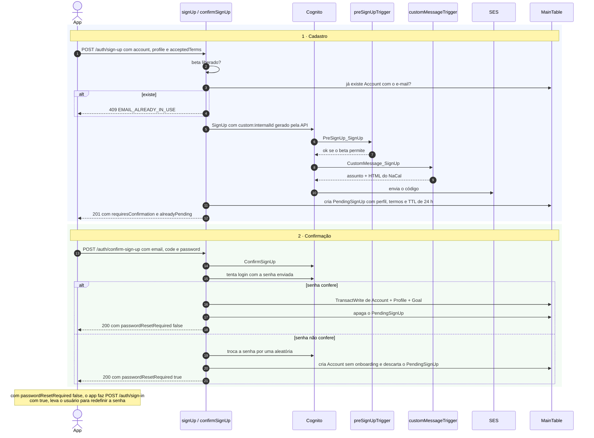
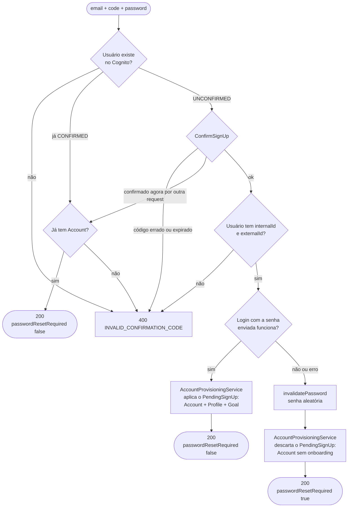
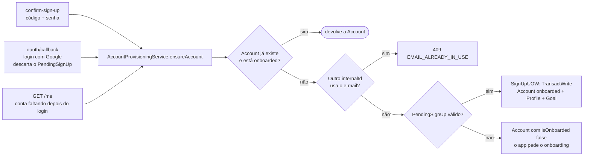

# Fluxo: cadastro por e-mail

## Resumo

O usuário preenche o onboarding (perfil e metas) **antes** de criar a conta. O `POST /auth/sign-up` cria o usuário no Cognito, ainda não confirmado, e guarda o perfil num **`PendingSignUp`** com validade de 24 h. A `Account`, o `Profile` e a `Goal` só são criados quando alguém prova que é dono do e-mail: pelo código de confirmação, pelo login com Google ou pelo primeiro `GET /me` depois de um login.

| | |
|---|---|
| **Rotas** | `POST /auth/sign-up` · `POST /auth/confirm-sign-up` · `POST /auth/resend-confirmation-code` |
| **Lambdas** | `signUp`, `confirmSignUp`, `resendConfirmationCode` + triggers `preSignUpTrigger` e `customMessageTrigger` |
| **Rate limit** | sign-up: 5 por IP a cada 15 min · confirmação: 10 por IP e 10 por e-mail a cada 15 min · reenvio: 3 por IP e 3 por e-mail a cada 15 min |
| **Beta fechado** | Com `BETA_GATE_ENABLED=true`, só e-mails de `BETA_ALLOWED_EMAILS` passam (`403 BETA_ACCESS_DENIED`) |

## Visão geral

## Por que o `PendingSignUp`?

Antes, a conta era criada já no sign-up. O problema: **qualquer um pode cadastrar qualquer e-mail**, e a conta ficaria com o perfil e a senha de quem não é o dono. Agora:

- O **código** prova quem tem acesso à caixa de entrada, mas não prova quem escolheu a senha.
- Por isso a confirmação **testa a senha** enviada junto com o código. Se não for a mesma do cadastro, os dados do cadastro são descartados e a senha vira uma aleatória que ninguém sabe. O dono do e-mail recupera o acesso por "esqueci a senha" (`passwordResetRequired: true` faz o app levar o usuário para lá).
- A senha é aparada (`trim`) no `sign-up`, no `sign-in`, no `confirm-sign-up` e no `confirmation-forgot-password`, e o app apara antes de enviar. O Cognito recusa senha que começa ou termina com espaço (`^[\S]+.*[\S]+$`), então a API nunca grava esses espaços. Sem o `trim` na confirmação, quem cadastrou `"  Senha#12345  "` e a repetia igual teria a senha tratada como errada e perderia o `PendingSignUp`.
- Falha ao testar a senha (throttling, timeout) conta como "não confere": é melhor obrigar o dono a redefinir a senha do que aceitar a senha de outra pessoa.

## Passo a passo

### Cadastro (`POST /auth/sign-up`)

1. Valida o corpo: `acceptedTerms` tem que ser `true`, a senha tem pelo menos 8 caracteres depois do `trim`, e o perfil vem completo (nome, gênero, altura, peso, nível de atividade, objetivo e nascimento).
2. Normaliza o e-mail (`normalizeEmail`) e checa o beta.
3. Se já existe `Account` com o e-mail, `409 EMAIL_ALREADY_IN_USE`, ou `409 EMAIL_LINKED_TO_GOOGLE` se o usuário do Cognito tem a identidade `Google`. O mesmo vale quando o usuário do Cognito existe e já está confirmado, mesmo sem `Account`: é o caso de quem começou o login com Google e não terminou (o `preSignUpTrigger` cria o usuário nativo, mas a `Account` só nasce no `oauth/callback`).
4. Gera o `accountId` e cria o usuário no Cognito com `custom:internalId = accountId`. O e-mail é o `username`.
5. Grava o `PendingSignUp` (perfil, versão dos termos, `expiresAt` em 24 h, apagado pelo TTL do DynamoDB). Se a gravação falhar, apaga o usuário do Cognito.
6. **Cadastro repetido de um e-mail ainda não confirmado**: o Cognito responde `UsernameExistsException`. A API apaga o usuário antigo e o `PendingSignUp` antigo e cria de novo, com a senha e o perfil novos e um código novo. A resposta vem com `alreadyPending: true`.

### Confirmação (`POST /auth/confirm-sign-up`)

Se o usuário já estiver confirmado, a API **não** aplica o `PendingSignUp` nesse caminho: a request não prova nada sobre quem a enviou. Quem aplica é o `GET /me` depois de um login com senha. O callback do Google descarta o `PendingSignUp` (ver [login com Google](auth-google-oauth.md#o-usuário-shadow-nativo)).

### Reenvio do código (`POST /auth/resend-confirmation-code`)

Só reenvia se o usuário existir e estiver `UNCONFIRMED`. Nos outros casos responde igual, sem dizer se o e-mail existe, para ninguém usar a rota para descobrir quais e-mails têm conta.

## `AccountProvisioningService`: o ponto único de criação de conta

Três caminhos criam a `Account` e todos passam pelo mesmo serviço, que é **idempotente**:

- A busca é pelo `internalId` (atributo imutável do Cognito), nunca pelo e-mail. O e-mail só serve para detectar conflito.
- Quem chama decide se o `PendingSignUp` pode ser aplicado (`skipPendingSignUp`). Ele só é aplicado quando quem chega prova a autoria do cadastro, ou seja, sabe a senha: `confirm-sign-up` com a senha certa e `GET /me` depois de um login com senha. O `confirm-sign-up` com a senha errada e o callback do Google apagam o `PendingSignUp` e criam a `Account` sem onboarding.
- A `Goal` é calculada pelo `GoalCalculator` a partir do perfil.
- O `SignUpUOW` grava a `Account` com condição (`attribute_not_exists(PK) OR isOnboarded = false`). Se duas chamadas aplicam o mesmo `PendingSignUp` ao mesmo tempo, a segunda transação é cancelada e o serviço devolve a `Account` relida do banco, sem erro (com uma nova tentativa se o cancelamento for por `TransactionConflict`). A `Account` sem onboarding também é criada com condição (`attribute_not_exists(PK)`): se outro caminho já gravou a conta, o serviço devolve a que está no banco em vez de sobrescrevê-la com `isOnboarded: false`.
- Se a criação falhar depois de o usuário ser confirmado, o próximo `GET /me` cria a conta (ele chama o serviço quando não acha a `Account`).

## E-mails

O Cognito envia os e-mails pelo SES. O `customMessageTrigger` troca o texto padrão pelo HTML do NaCal em `CustomMessage_SignUp`, `CustomMessage_ResendCode` e `CustomMessage_ForgotPassword`. O layout fica em `src/infra/emails/emailLayout.ts` e cada e-mail é um arquivo em `src/infra/emails/templates/`, escrito à mão em TypeScript, com versão HTML e versão em texto.

Restrições do Cognito que valem para qualquer mudança nos e-mails:

- **HTML só com `EmailSendingAccount: DEVELOPER`** (SES próprio, em `userPool.yaml`). Com `COGNITO_DEFAULT`, o Cognito recusa a resposta do trigger com `400 InvalidLambdaResponseException`.
- **Limite de 20.000 caracteres**, contando o código. Acima disso, o Cognito **descarta a mensagem sem erro** e manda o texto padrão dele. Por isso o trigger manda a versão em texto quando o HTML passa do limite.
- **5 s para o trigger responder**, fixos. Nada de chamada externa ou render pesado dentro dele.
- **Template no console sobrescreve o trigger.** Não configure template de e-mail no console do Cognito (hoje não há nenhum).

Para ver os e-mails renderizados no navegador: `npx tsx scripts/previewEmails.ts`, com cwd em `api/`.

## Erros

| Situação | Resposta |
|---|---|
| E-mail fora do beta | `403 BETA_ACCESS_DENIED` |
| E-mail já tem conta (no cadastro ou no provisionamento da confirmação) | `409 EMAIL_ALREADY_IN_USE` |
| No cadastro, o e-mail já está no Cognito ligado ao Google (com ou sem `Account`) | `409 EMAIL_LINKED_TO_GOOGLE` |
| Código errado, expirado, usuário inexistente ou sem `internalId`/`externalId` | `400 INVALID_CONFIRMATION_CODE` |
| Corpo fora do schema | `400 VALIDATION` |
| Muitas tentativas no Cognito | `429 TOO_MANY_ATTEMPTS` |
| Falha ao enviar o e-mail | `502 CODE_DELIVERY_FAILED` |
| Rate limit da API | `429 RATE_LIMIT_EXCEEDED` |

## Arquivos envolvidos

| Etapa | Arquivo |
|---|---|
| Schema do cadastro | [`signUpSchema.ts`](../../../src/application/controllers/auth/schemas/signUpSchema.ts) |
| Cadastro | [`SignUpUseCase.ts`](../../../src/application/useCases/auth/SignUpUseCase.ts) |
| Confirmação | [`ConfirmSignUpUseCase.ts`](../../../src/application/useCases/auth/ConfirmSignUpUseCase.ts) |
| Reenvio | [`ResendConfirmationCodeUseCase.ts`](../../../src/application/useCases/auth/ResendConfirmationCodeUseCase.ts) |
| Criação da conta | [`AccountProvisioningService.ts`](../../../src/application/services/AccountProvisioningService.ts), [`SignUpUOW.ts`](../../../src/infra/databases/dynamodb/uow/SignUpUOW.ts) |
| Cálculo da meta | [`GoalCalculator.ts`](../../../src/application/services/GoalCalculator.ts) |
| Cognito | [`AuthGateway.ts`](../../../src/infra/gateways/AuthGateway.ts), [`userPool.yaml`](../../../sls/resources/userPool.yaml) |
| Triggers | [`preSignUpTrigger.ts`](../../../src/main/functions/auth/preSignUpTrigger.ts), [`customMessageTrigger.ts`](../../../src/main/functions/auth/customMessageTrigger.ts) |
| Beta fechado | [`betaAccess.ts`](../../../src/shared/config/betaAccess.ts) |
