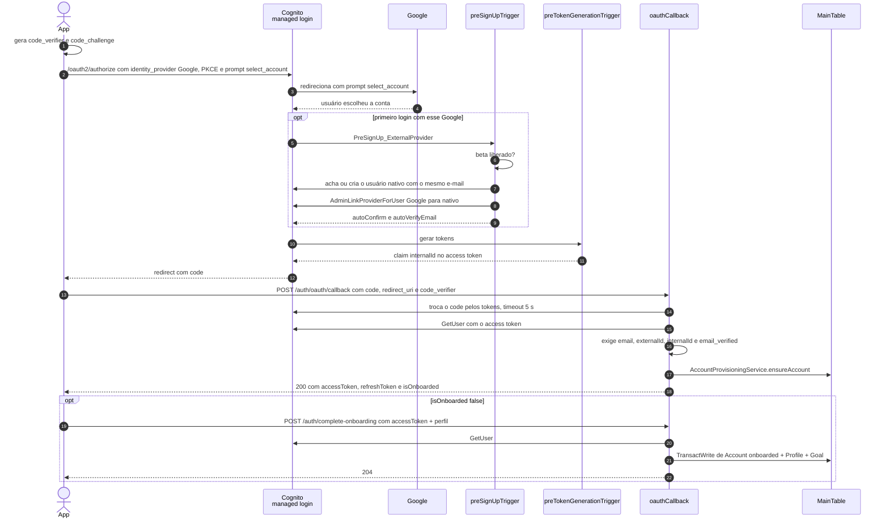
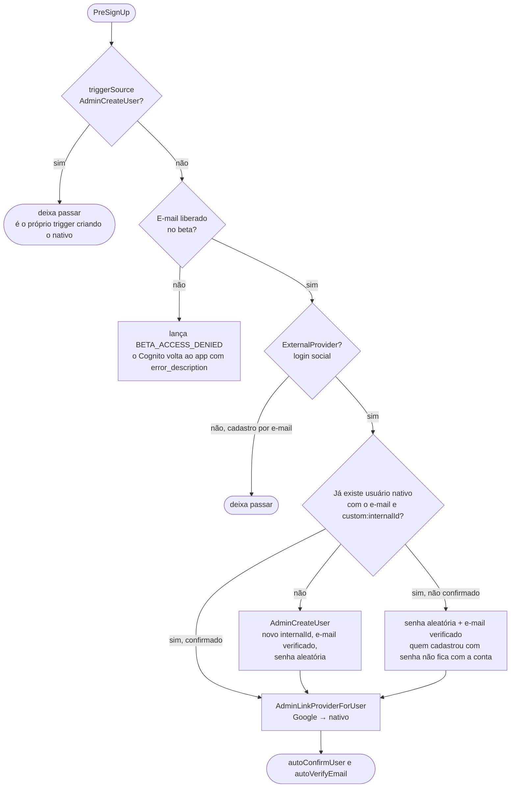

# Fluxo: login com Google

## Resumo

O login com Google usa **Authorization Code + PKCE** pelo domínio do Cognito (managed login). No primeiro login, o trigger `PreSignUp` cria (ou reaproveita) um usuário **nativo** do Cognito com o mesmo e-mail e vincula a identidade do Google a ele. Assim, a mesma pessoa tem um `internalId` só, entre no app com senha ou com Google. Depois, o app troca o `code` pelos tokens na API, que garante a `Account` e diz se falta o onboarding.

| | |
|---|---|
| **Rotas** | `POST /auth/oauth/callback` · `POST /auth/complete-onboarding` |
| **Lambdas** | `oauthCallback`, `completeOnboarding` + triggers `preSignUpTrigger` e `preTokenGenerationTrigger` |
| **Rate limit** | 30 por IP a cada 15 min, nas duas rotas |

## Diagrama de sequência

## O usuário "shadow" (nativo)

Quando alguém entra com o Google, o Cognito cria um usuário do tipo `Google_<id>`. Sem tratamento, a mesma pessoa teria **dois usuários** se também se cadastrasse com senha. O `preSignUpTrigger` evita isso:

- **Cadastro por e-mail não confirmado + login com Google**: o Google prova o e-mail, então o trigger confirma o nativo e troca a senha por uma aleatória. O `PendingSignUp` desse cadastro é aplicado no callback, então os dados do onboarding não se perdem.
- O `preTokenGenerationTrigger` (V2) copia `custom:internalId` para o claim `internalId` do access token. É esse claim que o `lambdaHttpAdapter` lê como `accountId` em toda rota privada.

## Passo a passo

### Callback (`POST /auth/oauth/callback`)

1. Troca `code` + `code_verifier` pelos tokens no endpoint `/oauth2/token` do domínio do Cognito, com timeout de 5 s. Resposta de erro do Cognito ou sem tokens vira `400 INVALID_GRANT`. Timeout ou falha de rede vira `500`.
2. Lê o usuário com `GetUser` e exige `email`, `externalId`, `internalId` e `email_verified`. Faltou algo: `400 INVALID_GRANT`.
3. Chama o [`AccountProvisioningService`](auth-cadastro-email.md#accountprovisioningservice-o-ponto-único-de-criação-de-conta): devolve a `Account` existente, aplica um `PendingSignUp` válido ou cria uma `Account` com `isOnboarded: false`.
4. Responde `200` com `{ accessToken, refreshToken, isOnboarded }`.

### Onboarding (`POST /auth/complete-onboarding`)

Rota **pública** no API Gateway: o `accessToken` vai no corpo e a API valida chamando `GetUser` no Cognito.

1. Lê `name`, `email` e `externalId` do usuário.
2. Busca a `Account` pelo e-mail. Não existe: `404 RESOURCE_NOT_FOUND`. Existe com outro `externalId`: `409 EMAIL_ALREADY_IN_USE`. É a exceção à regra de buscar a conta pelo `internalId` (ver [cadastro por e-mail](auth-cadastro-email.md#accountprovisioningservice-o-ponto-único-de-criação-de-conta)). A checagem do `externalId` é o que impede usar a conta de outra pessoa.
3. Cria `Profile` e `Goal`, recalcula a meta e marca a conta como `isOnboarded`, com os termos aceitos agora, numa transação só (`SignUpUOW`, com `Put` sem condição). O retry com o **mesmo corpo** é seguro. A rota não confere `isOnboarded`: uma chamada com outros dados sobrescreve perfil e meta, inclusive de uma conta já onboarded, e apaga edições feitas depois por `PUT /profiles` e `POST /goals`.

Como o claim `internalId` já vem no primeiro token, o app não precisa renovar o token depois do onboarding.

## Pontos de atenção

- **`prompt=select_account`** só chega ao Google com o domínio em managed login (`ManagedLoginVersion: 2` em `userPool.yaml`). No hosted UI clássico ele é descartado e o Google entra direto na última conta usada. Não mude o domínio pelo console.
- **PWA de dev no iOS** não completa o login com Google (o `code` se perde quando o iOS recarrega o PWA). Valide em prod ou no navegador.
- **Beta fechado**: o erro do trigger não chega à API. O Cognito redireciona de volta ao app com `error_description` contendo `BETA_ACCESS_DENIED`, e o app mostra a mensagem do beta.

## Erros

| Situação | Resposta |
|---|---|
| `code` inválido, expirado ou com o `code_verifier` errado | `400 INVALID_GRANT` |
| Token sem e-mail verificado ou sem `internalId` | `400 INVALID_GRANT` |
| E-mail já usado por outro `internalId` | `409 EMAIL_ALREADY_IN_USE` |
| Timeout ou falha de rede na troca do `code` | `500 INTERNAL_SERVER_ERROR` |
| Onboarding com `accessToken` inválido, expirado ou usuário sem `name` | `400 INVALID_GRANT` |
| Onboarding sem `Account` | `404 RESOURCE_NOT_FOUND` |
| Onboarding com `Account` de outro `externalId` | `409 EMAIL_ALREADY_IN_USE` |
| Corpo fora do schema | `400 VALIDATION` |
| Fora do beta | Volta ao app com `error_description` contendo `BETA_ACCESS_DENIED` |

## Arquivos envolvidos

| Etapa | Arquivo |
|---|---|
| Callback | [`OAuthCallbackUseCase.ts`](../../../src/application/useCases/auth/OAuthCallbackUseCase.ts) |
| Onboarding | [`CompleteOnboardingUseCase.ts`](../../../src/application/useCases/auth/CompleteOnboardingUseCase.ts) |
| Troca de code e `GetUser` | [`AuthGateway.ts`](../../../src/infra/gateways/AuthGateway.ts) |
| Usuário shadow | [`preSignUpTrigger.ts`](../../../src/main/functions/auth/preSignUpTrigger.ts) |
| Claim `internalId` | [`preTokenGenerationTrigger.ts`](../../../src/main/functions/auth/preTokenGenerationTrigger.ts) |
| User pool, client e domínio | [`userPool.yaml`](../../../sls/resources/userPool.yaml) |
| Lado do app | `app/src/app/hooks/useSocialAuth.ts` (repo do app) |
