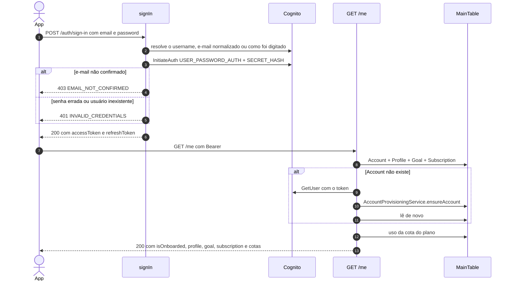
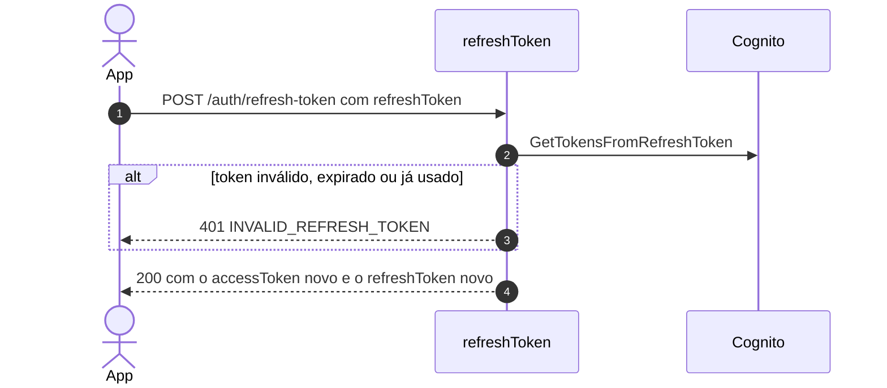
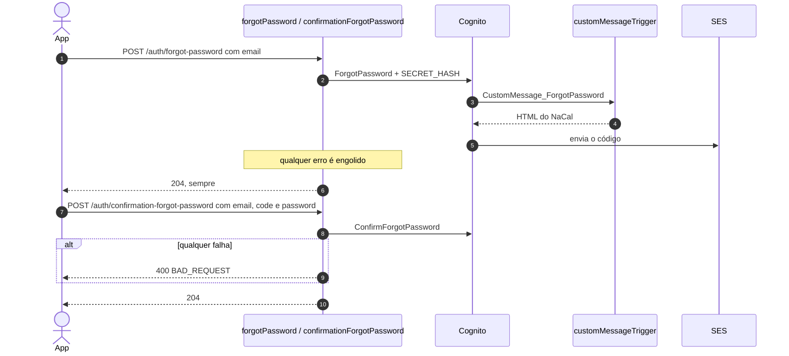

# Fluxo: login, refresh token e senha

## Resumo

Login com e-mail e senha, renovação do token e recuperação de senha. A API é uma camada fina sobre o Cognito: traduz os erros do Cognito em erros da API, aplica o rate limit e calcula o `SECRET_HASH` exigido pelo client do Cognito, para o segredo nunca ir para o app.

| Ação | Rota | Rate limit |
|---|---|---|
| Login | `POST /auth/sign-in` | 10 por IP e 10 por e-mail a cada 15 min |
| Renovar token | `POST /auth/refresh-token` | 60 por IP a cada 15 min |
| Pedir código de nova senha | `POST /auth/forgot-password` | 5 por IP a cada 15 min e 5 por e-mail por hora |
| Definir nova senha | `POST /auth/confirmation-forgot-password` | 10 por IP a cada 15 min |
| Dados do usuário | 🔒 `GET /me` | — |

## Tokens

| Token | Validade | Uso |
|---|---|---|
| Access token | 1 dia | `Authorization: Bearer ...` em toda rota 🔒. Traz o claim `internalId`. |
| Refresh token | 7 dias, com **rotação** | Gera um novo par. O refresh token antigo deixa de valer na hora (sem período de tolerância). |

## Login e primeiro `GET /me`

- **Senha errada e usuário inexistente dão o mesmo erro** (`INVALID_CREDENTIALS`), para não revelar quais e-mails têm conta.
- **`resolveUsername`**: usuários antigos podem ter sido criados com o e-mail exatamente como foi digitado (com maiúsculas). A API tenta o e-mail normalizado e, se não existir, o original.
- **`GET /me` conserta conta faltando.** Se o usuário existe no Cognito mas não tem `Account` (a criação falhou depois da confirmação), o `GET /me` cria a conta na hora, aplicando o `PendingSignUp` se ele ainda for válido. Ele exige `email_verified` e que o `internalId` do token seja o mesmo da request.

## Refresh token

Com a rotação ligada, o app **precisa guardar o refresh token novo** de cada resposta. Reusar o antigo dá `INVALID_REFRESH_TOKEN` e o usuário tem que entrar de novo.

## Esqueci a senha

- **`forgot-password` responde sempre `204`**, mesmo com e-mail inexistente, throttling do Cognito ou falha no envio do e-mail. Assim a rota não revela quais e-mails têm conta. O lado ruim é que o app não fica sabendo de uma falha real de envio.
- **`confirmation-forgot-password` responde `400 BAD_REQUEST`** ("Invalid code provided, please request a code again") em **qualquer** falha: código errado ou expirado, senha fora da política, throttling. O app trata tudo como "peça um código novo".

Esse também é o caminho de recuperação de quem confirmou o cadastro com uma senha diferente da cadastrada (`passwordResetRequired: true`, ver [cadastro por e-mail](auth-cadastro-email.md#por-que-o-pendingsignup)).

## Erros

| Situação | Resposta |
|---|---|
| Senha errada ou usuário inexistente | `401 INVALID_CREDENTIALS` |
| E-mail não confirmado | `403 EMAIL_NOT_CONFIRMED` |
| Refresh token inválido ou já usado | `401 INVALID_REFRESH_TOKEN` |
| Throttling do Cognito no login (`LimitExceeded`, `TooManyFailedAttempts`, `TooManyRequests`) | `429 TOO_MANY_ATTEMPTS` |
| Qualquer erro do Cognito no refresh, inclusive throttling ou rede | `401 INVALID_REFRESH_TOKEN` |
| Qualquer erro em `forgot-password` | `204` (o erro não aparece) |
| Qualquer erro em `confirmation-forgot-password` | `400 BAD_REQUEST` |
| `GET /me` sem `Account`, com token sem `email_verified` ou `internalId` diferente | `404 RESOURCE_NOT_FOUND` |
| `GET /me` sem `Account` e o e-mail já é de outra conta | `409 EMAIL_ALREADY_IN_USE` |
| Corpo fora do schema | `400 VALIDATION` |
| Rate limit da API | `429 RATE_LIMIT_EXCEEDED` |

## Arquivos envolvidos

| Etapa | Arquivo |
|---|---|
| Login | [`SignInUseCase.ts`](../../../src/application/useCases/auth/SignInUseCase.ts) |
| Refresh | [`RefreshTokenUseCase.ts`](../../../src/application/useCases/auth/RefreshTokenUseCase.ts) |
| Esqueci a senha | [`ForgotPasswordUseCase.ts`](../../../src/application/useCases/auth/ForgotPasswordUseCase.ts), [`ConfirmForgotPasswordUseCase.ts`](../../../src/application/useCases/auth/ConfirmForgotPasswordUseCase.ts) |
| `GET /me` | [`GetMeController.ts`](../../../src/application/controllers/accounts/GetMeController.ts), [`GetProfileAndGoalByAccountId.ts`](../../../src/application/query/GetProfileAndGoalByAccountId.ts) |
| Cognito, `SECRET_HASH` e mapeamento de throttling | [`AuthGateway.ts`](../../../src/infra/gateways/AuthGateway.ts) |
| Validade e rotação dos tokens | [`userPool.yaml`](../../../sls/resources/userPool.yaml) |
