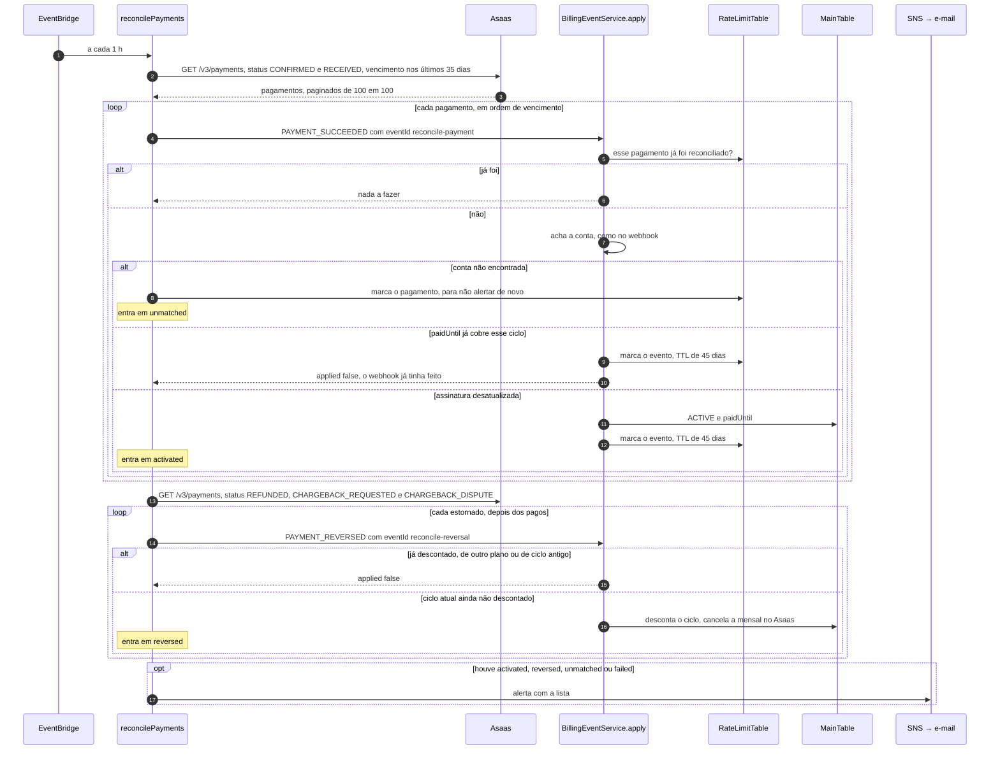

# Fluxo: reconciliação de pagamentos

## Resumo

Uma Lambda agendada roda **de hora em hora**, lista no Asaas os pagamentos confirmados e os estornados (estorno total ou chargeback) dos últimos 35 dias e passa cada um pela **mesma lógica do webhook** (`BillingEventService.apply`). Se o webhook já tinha feito o trabalho, nada muda. Se ele se perdeu, a assinatura é ativada (ou o ciclo estornado é descontado) e o time recebe um e-mail. É a rede de segurança do [billing](billing.md).

| | |
|---|---|
| **Lambda** | `reconcilePayments` (timeout de 60 s, sem retry automático) |
| **Gatilho** | EventBridge `rate(1 hour)` |
| **Quando fica ligada** | Só quando `ASAAS_BASE_URL` é `https://api.asaas.com` (produção). No sandbox, o schedule é criado desligado (`sls/config/reconcileScheduleEnabled.js`). |
| **Janela** | 35 dias pelo vencimento. Pode ser mudada na invocação manual com `{ "lookbackDays": N }`, até 365. |

## Diagrama de sequência



## Como ela evita trabalho e alarmes repetidos

- **Marcador por pagamento**: cada pagamento vira o evento `reconcile-payment#<paymentId>`, gravado na `RateLimitTable` com TTL de 35 + 10 dias. Na hora seguinte ele é pulado sem consultar a assinatura.
- **Pagamento coberto**: se o `paidUntil` da assinatura já cobre o ciclo daquele pagamento, o webhook fez o trabalho e nada é gravado (`applied: false`). O webhook segue a mesma regra; a diferença é que, com `skipCoveredPayment`, a reconciliação também não dispara o alerta de assinatura por cima do anual. Só os casos em que a reconciliação **mudou** algo entram em `activated`.
- **Ordem por vencimento**: os pagamentos antigos são aplicados antes, para o primeiro pagamento de uma assinatura criar o vínculo `GATEWAY#` antes da renovação e o `paidUntil` avançar na ordem certa.
- **Estornos**: os status `REFUNDED`, `CHARGEBACK_REQUESTED` e `CHARGEBACK_DISPUTE` (estes dois como chargeback aberto) passam pelo mesmo desconto do webhook ([Estorno e chargeback](billing.md#estorno-e-chargeback)), depois dos pagamentos confirmados e com o marcador `reconcile-reversal#<paymentId>`. A idempotência vem do `reversedPaymentIds` da assinatura: o estorno que o webhook já descontou dá `applied: false`. A reconciliação não manda o alerta de estorno por evento (o webhook manda); só os descontos feitos por ela entram no e-mail, em `reversed`. Estorno parcial e disputa ganha não entram (só o webhook alerta). Um estorno de pagamento com vencimento anterior à janela (ex.: anual pago há mais de 35 dias) só é visto pelo webhook ou numa invocação manual com `lookbackDays` maior.
- **Fora do escopo**: `PAYMENT_OVERDUE` e cancelamentos perdidos. Um cancelamento perdido (o `SUBSCRIPTION_DELETED` que não chegou, ou um cancelamento no Asaas cuja gravação falhou) não dá Pro por tempo indeterminado: com o status preso em `ACTIVE`, o `resolveEffectivePlan` mantém o Pro só até `paidUntil` + 3 dias (`GRACE_DAYS`), porque o `paidUntil` só avança com pagamento confirmado. O erro fica só na tela (o app mostra a assinatura ativa). O cancelamento pelo app é síncrono e não depende do webhook.

## O e-mail de alerta

Vai para o tópico `DQLAlarmTopic` (o mesmo das DLQs) quando há alguma divergência (o que fazer com cada lista também está no [runbook de alertas](../runbooks/alertas.md#reconciliação-encontrou-divergências)):

| Lista | Significado | O que fazer |
|---|---|---|
| **Ativados pela reconciliação** | O webhook não ativou e a reconciliação ativou | Conferir por que o webhook falhou (logs da `webhookAsaas`, painel do Asaas) |
| **Estornos ou chargebacks aplicados** | O webhook do estorno não chegou e a reconciliação descontou o ciclo | Conferir no painel do Asaas e nos logs da `webhookAsaas` |
| **Pagos ou estornados sem conta correspondente** | Pagamento sem `externalReference` e sem item `GATEWAY#` | Achar o cliente no painel do Asaas e ligar à conta manualmente |
| **Com erro** | Falha ao aplicar | Nada: o pagamento é tentado de novo na próxima hora (não foi marcado) |

Além disso, o alarme `ReconcilePaymentsErrorsAlarm` (em `sls/resources/reconcilePaymentsAlarm.yml`) dispara se a própria Lambda der erro numa janela de 5 minutos.

## Rodar na mão

```bash
AWS_PROFILE=nacal-prod sls invoke -f reconcilePayments --stage prod --data '{"lookbackDays": 90}'
```

A resposta traz `checked`, `activated`, `reversed`, `unmatched` e `failed`.

## Arquivos envolvidos

| Etapa | Arquivo |
|---|---|
| Schedule | [`sls/functions/billing.yml`](../../../sls/functions/billing.yml), [`reconcileScheduleEnabled.js`](../../../sls/config/reconcileScheduleEnabled.js) |
| Handler | [`ReconcilePaymentsScheduleHandler.ts`](../../../src/application/schedules/ReconcilePaymentsScheduleHandler.ts) |
| Use case | [`ReconcilePaymentsUseCase.ts`](../../../src/application/useCases/billing/ReconcilePaymentsUseCase.ts) |
| Lógica compartilhada com o webhook | [`BillingEventService.ts`](../../../src/application/services/BillingEventService.ts) |
| Listagem no Asaas | [`AsaasPaymentGateway.ts`](../../../src/infra/gateways/AsaasPaymentGateway.ts) (`listPaidPayments`, `listReversedPayments`) |
| Alerta | [`AlertGateway.ts`](../../../src/infra/gateways/AlertGateway.ts) |
| Alarme | [`reconcilePaymentsAlarm.yml`](../../../sls/resources/reconcilePaymentsAlarm.yml) |
