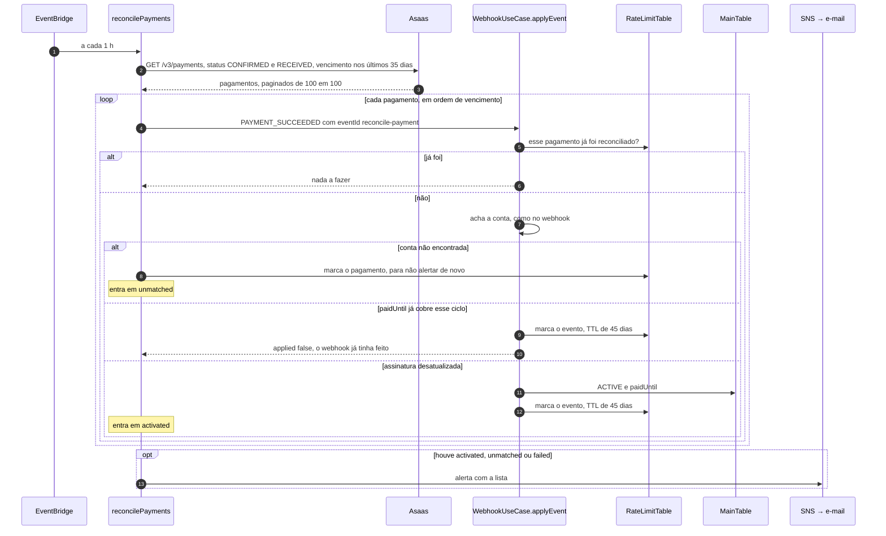

# Fluxo: reconciliação de pagamentos

## Resumo

Uma Lambda agendada roda **de hora em hora**, lista no Asaas os pagamentos confirmados dos últimos 35 dias e passa cada um pela **mesma lógica do webhook** (`WebhookUseCase.applyEvent`). Se o webhook já tinha feito o trabalho, nada muda. Se ele se perdeu, a assinatura é ativada e o time recebe um e-mail. É a rede de segurança do [billing](billing.md).

| | |
|---|---|
| **Lambda** | `reconcilePayments` (timeout de 60 s, sem retry automático) |
| **Gatilho** | EventBridge `rate(1 hour)` |
| **Quando fica ligada** | Só quando `ASAAS_BASE_URL` é `https://api.asaas.com` (produção). No sandbox, o schedule é criado desligado (`sls/config/reconcileScheduleEnabled.js`). |
| **Janela** | 35 dias pelo vencimento. Pode ser mudada na invocação manual com `{ "lookbackDays": N }`, até 365. |

## Diagrama de sequência



## Como ela evita trabalho e alarmes repetidos

- **Marcador por pagamento**: cada pagamento vira o evento `reconcile-payment#<paymentId>`, gravado na `RateLimitTable` com TTL de 35 + 10 dias. Na hora seguinte ele é pulado sem consultar a assinatura.
- **`skipCoveredPayment`**: se o `paidUntil` da assinatura já cobre o ciclo daquele pagamento, o webhook fez o trabalho e nada é gravado (`applied: false`). Só os casos em que a reconciliação **mudou** algo entram em `activated`.
- **Ordem por vencimento**: os pagamentos antigos são aplicados antes, para o primeiro pagamento de uma assinatura criar o vínculo `GATEWAY#` antes da renovação e o `paidUntil` avançar na ordem certa.
- **Fora do escopo**: `PAYMENT_OVERDUE` e cancelamentos perdidos. A reconciliação só olha pagamentos confirmados.

## O e-mail de alerta

Vai para o tópico `DQLAlarmTopic` (o mesmo das DLQs) quando há alguma divergência:

| Lista | Significado | O que fazer |
|---|---|---|
| **Ativados pela reconciliação** | O webhook não ativou e a reconciliação ativou | Conferir por que o webhook falhou (logs da `webhookAsaas`, painel do Asaas) |
| **Pagos sem conta correspondente** | Pagamento sem `externalReference` e sem item `GATEWAY#` | Achar o cliente no painel do Asaas e ligar à conta manualmente |
| **Com erro** | Falha ao aplicar | Nada: o pagamento é tentado de novo na próxima hora (não foi marcado) |

Além disso, o alarme `ReconcilePaymentsErrorsAlarm` (em `sls/resources/reconcilePaymentsAlarm.yml`) dispara se a própria Lambda der erro numa janela de 5 minutos.

## Rodar na mão

```bash
AWS_PROFILE=nacal-prod sls invoke -f reconcilePayments --stage prod --data '{"lookbackDays": 90}'
```

A resposta traz `checked`, `activated`, `unmatched` e `failed`.

## Arquivos envolvidos

| Etapa | Arquivo |
|---|---|
| Schedule | [`sls/functions/billing.yml`](../../../sls/functions/billing.yml), [`reconcileScheduleEnabled.js`](../../../sls/config/reconcileScheduleEnabled.js) |
| Handler | [`ReconcilePaymentsScheduleHandler.ts`](../../../src/application/schedules/ReconcilePaymentsScheduleHandler.ts) |
| Use case | [`ReconcilePaymentsUseCase.ts`](../../../src/application/useCases/billing/ReconcilePaymentsUseCase.ts) |
| Lógica compartilhada com o webhook | [`WebhookUseCase.ts`](../../../src/application/useCases/billing/WebhookUseCase.ts) |
| Listagem no Asaas | [`AsaasPaymentGateway.ts`](../../../src/infra/gateways/AsaasPaymentGateway.ts) (`listPaidPayments`) |
| Alerta | [`AlertGateway.ts`](../../../src/infra/gateways/AlertGateway.ts) |
| Alarme | [`reconcilePaymentsAlarm.yml`](../../../sls/resources/reconcilePaymentsAlarm.yml) |
