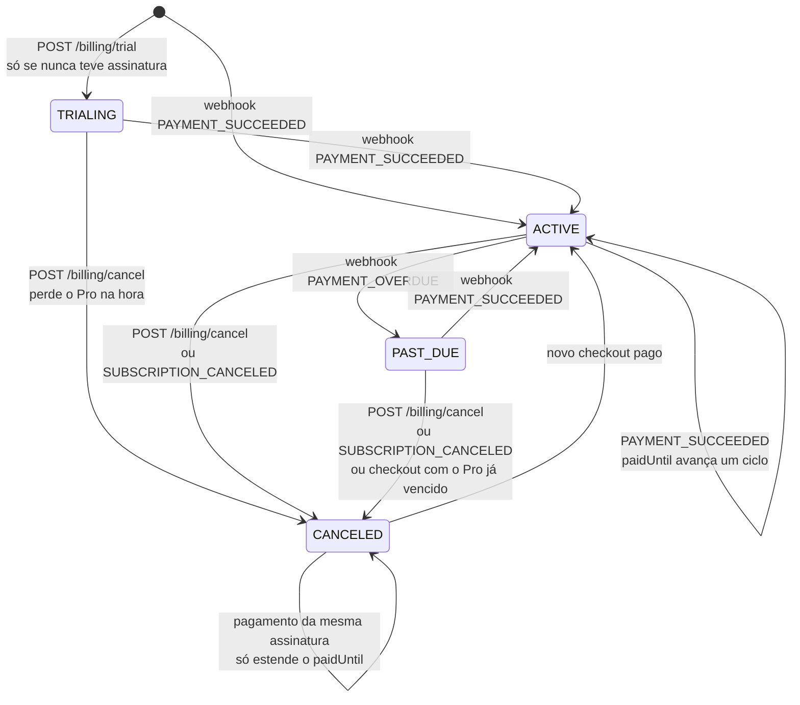
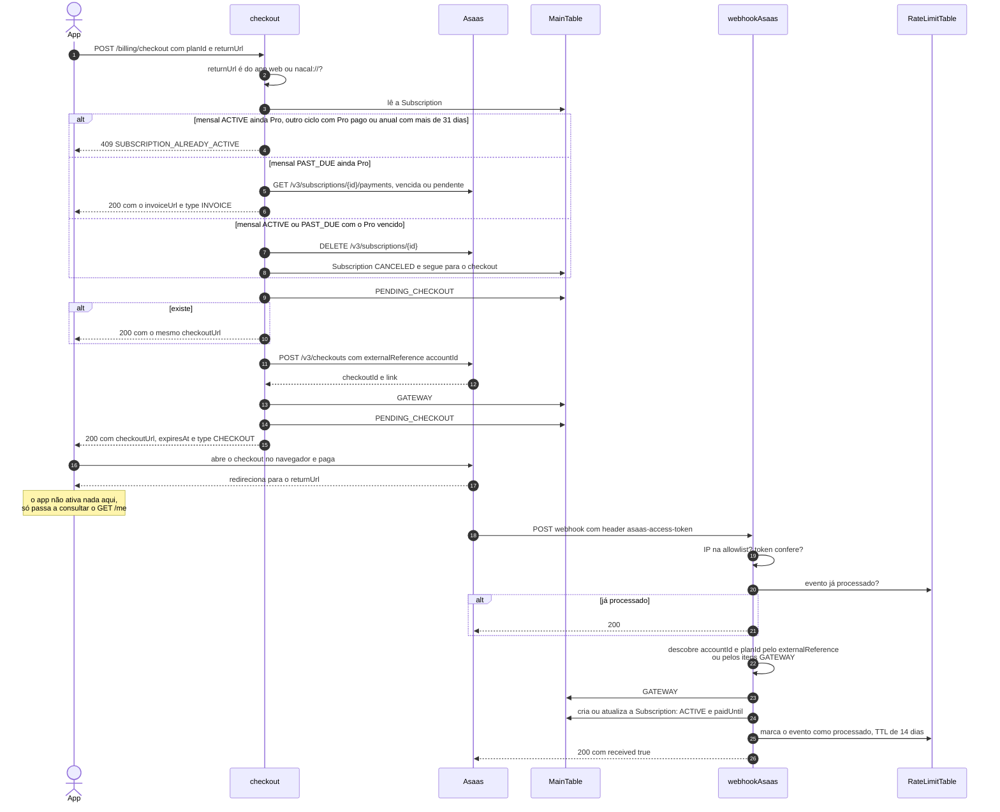

# Fluxo: planos, trial, checkout e webhook (billing)

## Resumo

O plano pago (Pro) é cobrado pelo **Asaas**. O app pede um link de checkout, o usuário paga na página do Asaas e o **webhook** do Asaas é a fonte da verdade: só ele ativa ou renova a assinatura. A API nunca confia no retorno do navegador. Uma [reconciliação horária](billing-reconciliacao.md) cobre webhooks perdidos.

Os use cases não conhecem o Asaas: falam com o contrato `IPaymentGateway`, ligado ao `AsaasPaymentGateway` em `src/main/di/bindings.ts`.

| Ação | Rota | Lambda |
|---|---|---|
| Listar planos | 🔒 `GET /billing/plans` | `plans` |
| Começar o trial | 🔒 `POST /billing/trial` (5 por hora por conta) | `trial` |
| Criar checkout | 🔒 `POST /billing/checkout` com `{ planId, returnUrl }` (10 por hora por conta) | `checkout` |
| Cancelar | 🔒 `POST /billing/cancel` (10 por hora por conta) | `cancel` |
| Webhook do Asaas | `POST /billing/webhooks/asaas` (token + allowlist de IP, 120 por minuto por IP) | `webhookAsaas` |
| Reconciliação | Schedule de 1 h | `reconcilePayments` |

## Planos

| Plano | Preço | Cobrança no Asaas | Pagamento |
|---|---|---|---|
| Free | — | — | 20 refeições com IA por mês |
| `PRO_MONTHLY` | R$ 9,99 por mês | Assinatura recorrente (`RECURRENT`) | Só cartão |
| `PRO_YEARLY` | R$ 89,90 por ano | Cobrança avulsa (`DETACHED`), renovada pelo usuário | Pix ou cartão |

Pro: até 20 refeições com IA por dia. Trial: 7 dias de Pro, uma vez por conta. Os valores ficam em `Subscription.Plan` (`src/application/entities/Subscription.ts`).

## Estados da assinatura

Os webhooks `PAYMENT_OVERDUE` e `SUBSCRIPTION_CANCELED` valem para **qualquer status diferente de `CANCELED`**, inclusive `TRIALING`, desde que sejam da assinatura do Asaas guardada em `gatewayRefs.subscriptionId` (ou que um dos dois lados não tenha referência). O diagrama mostra só os casos comuns.

O **status não decide sozinho** se o usuário é Pro. Quem decide é `Subscription.resolveEffectivePlan`, chamado em toda criação de refeição e no `GET /me`:

| Status | É Pro enquanto... |
|---|---|
| `TRIALING` | `trialEndsAt` não passou |
| `ACTIVE` ou `PAST_DUE` | `paidUntil` + 3 dias de carência (`GRACE_DAYS`) não passou |
| `CANCELED` | `paidUntil` não passou: quem cancela continua Pro até o fim do que pagou |
| `EXPIRED` ou sem assinatura | Nunca: é Free |

Por isso não existe job que "expira" assinaturas: o plano é calculado na hora, a partir das datas. O status `EXPIRED` existe no tipo, mas nenhum fluxo o grava hoje.

## Checkout e ativação

### Passo a passo do checkout

1. Valida o `planId` e o `returnUrl`: ele tem que ser o `APP_WEB_URL` (ou um caminho dentro dele) ou começar com `nacal://` (app nativo). Isso evita usar o checkout para mandar o usuário para um site qualquer.
2. **Confere a assinatura atual**, para nunca nascer uma segunda assinatura no Asaas cobrando junto com a primeira. Só `ACTIVE` e `PAST_DUE` entram nesta regra; sem assinatura, `TRIALING` e `CANCELED` seguem direto para o passo 3.
   - **Mensal com `subscriptionId`, `PAST_DUE` e ainda Pro** (dentro do `paidUntil` + 3 dias): não cria checkout. Busca a cobrança vencida mais recente da assinatura atual (ou, sem vencida, a pendente com vencimento até hoje, nunca a do próximo ciclo) e devolve o `invoiceUrl` dela, com `type: 'INVOICE'` e `expiresAt: null`. Pagar essa fatura dispara o `PAYMENT_SUCCEEDED` da mesma assinatura, que volta a `ACTIVE`. Se a pessoa paga com outro cartão, o Asaas troca o cartão da assinatura e as próximas cobranças já saem nele (conferido no sandbox em 2026-11-15). O Asaas gera a cobrança do mês seguinte com antecedência, mesmo com a atual em aberto: por isso a pendente só vale com vencimento até hoje. Sem cobrança em aberto (o pagamento acabou de entrar): `409`. Pedir o anual nesse estado também dá `409`.
   - **Mensal com `subscriptionId` e o Pro já vencido** (`PAST_DUE`, ou `ACTIVE` preso por falta de pagamento): cancela a assinatura antiga no Asaas (o que apaga as cobranças vencidas dela), grava `CANCELED` e segue para o checkout do plano pedido. O `DELETE` do Asaas é idempotente.
   - **Mensal com `subscriptionId`, `ACTIVE` e ainda Pro**: `409 SUBSCRIPTION_ALREADY_ACTIVE`, para qualquer plano. Trocar de ciclo continua bloqueado: cancela e assina o outro depois que o atual vencer.
   - **Anual (cobrança avulsa) ou mensal sem `subscriptionId`**, com o `paidUntil` no futuro: só aceita renovar o próprio anual nos últimos 31 dias (os 30 do aviso do app mais um de folga para o fuso). Fora disso, ou pedindo o mensal, `409`. Com o `paidUntil` no passado (carência ou vencido), aceita qualquer plano.
3. **Reaproveita o checkout recente**: se o item `PENDING_CHECKOUT#<accountId>` é do mesmo plano e do mesmo `returnUrl` e ainda faltam mais de 10 minutos para expirar, devolve o mesmo link. Duas abas ou dois aparelhos abrem o mesmo checkout, que só pode ser pago uma vez. Não cobre dois pedidos no mesmo instante (os dois criam checkout, porque a gravação não é condicional) nem a troca de plano antes de pagar (o checkout do outro plano continua pagável até expirar): nesses casos, quem avisa é o alerta do webhook.
4. Cria o checkout no Asaas com `externalReference = "<accountId>#<planId>"`. É assim que o webhook descobre de quem é o pagamento.
5. Grava um item `GATEWAY#<checkoutId>` com `accountId` e `planId`. É o plano B para identificar a conta quando o evento do Asaas vem sem `externalReference` (pagamentos de assinatura recorrente, por exemplo).
6. Grava o `PENDING_CHECKOUT#<accountId>` com o link, o plano, o `returnUrl` e a expiração (TTL na mesma hora). Os webhooks `CHECKOUT_PAID`, `CHECKOUT_CANCELED` e `CHECKOUT_EXPIRED` apagam o item, para o passo 3 não devolver um link que não serve mais.

A resposta é `{ checkoutUrl, expiresAt, type }`. Com `type: 'INVOICE'`, o app abre a fatura em outra aba no web (a fatura do Asaas não volta para o `returnUrl`) e mostra o painel "Já paguei". No nativo, o fluxo é o mesmo do checkout.

### Passo a passo do webhook

1. **Segurança**: o `@IpAllowlist` recusa IPs fora de `ASAAS_WEBHOOK_ALLOWED_IPS` (`403`). Sem a variável, valem os 4 IPs oficiais de produção do Asaas (`ASAAS_WEBHOOK_PRODUCTION_IPS` em `AppConfig.ts`). `*` desliga a checagem, para sandbox e dev. Depois, `parseWebhook` compara o header `asaas-access-token` com `ASAAS_WEBHOOK_TOKEN`. Token errado lança `BillingError` (`502`).
2. **Tradução**: o evento do Asaas vira um `BillingEvent` neutro. `PAYMENT_CONFIRMED` e `PAYMENT_RECEIVED` viram `PAYMENT_SUCCEEDED`. `SUBSCRIPTION_CANCELED` e `SUBSCRIPTION_DELETED` viram `SUBSCRIPTION_CANCELED`. Eventos desconhecidos são ignorados (`200 { received: false }`).
3. **Idempotência**: o `id` do evento é gravado na `RateLimitTable` (`RL#webhook-event#<id>`, TTL de 14 dias). Um evento repetido responde `200` sem fazer nada.
4. **Quem é o dono**: pelo `externalReference`. Se não vier, pelo item `GATEWAY#<checkoutSession>` (ou `GATEWAY#<checkoutId>` nos eventos de checkout) e, por último, pelo `GATEWAY#<subscriptionId>`. Sem dono, responde `200 { received: false }`. A reconciliação acusa esse pagamento depois.
5. **Aplicação**:
   - **Pagamento já coberto**: se o `paidUntil` já cobre o ciclo do pagamento (vencimento + 1 ciclo), nada é gravado (`applied: false`): nem status, nem plano, nem `subscriptionId`. É o caso do `PAYMENT_RECEIVED` do cartão, que chega uns 30 dias depois do `PAYMENT_CONFIRMED` e, sem essa regra, tiraria a conta de `PAST_DUE` ou trocaria a assinatura guardada por uma antiga.
   - `PAYMENT_SUCCEEDED`: status `ACTIVE`, `planId` do plano pago (quem fez o trial e pagou o anual passa a `PRO_YEARLY`) e `paidUntil = vencimento + 1 ciclo`. Nunca **reduz** um `paidUntil` existente, então o segundo evento do mesmo pagamento não soma de novo.
   - **Renovação adiantada do anual**: se o anual ainda vale, soma um ano ao `paidUntil` atual em vez de contar do vencimento, para o assinante não perder os dias que faltavam. Limite conhecido: dois pagamentos do anual com menos de um ano entre os vencimentos, ambos antes do `paidUntil`, contam como um só (o app só oferece renovar nos últimos 30 dias).
   - **Pagamento de assinatura já cancelada**: um pagamento da **mesma** assinatura do Asaas que o usuário cancelou (`gatewayRefs.subscriptionId`) não reativa, só estende o `paidUntil`. Isso cobre o `PAYMENT_RECEIVED` do cartão, que chega uns 30 dias depois do `PAYMENT_CONFIRMED`. Pagamento de uma assinatura nova reativa normalmente.
   - `PAYMENT_OVERDUE`: status `PAST_DUE`, exceto se já estiver `CANCELED`. A carência de 3 dias mantém o Pro enquanto o usuário paga a fatura vencida pelo app ("Pagar agora").
   - `SUBSCRIPTION_CANCELED`: status `CANCELED`, com `canceledAt`, exceto se já estiver `CANCELED`.
   - `PAYMENT_OVERDUE` e `SUBSCRIPTION_CANCELED` de uma assinatura do Asaas **diferente** da guardada são ignorados. Sem isso, o `SUBSCRIPTION_DELETED` atrasado da assinatura antiga (cancelada no checkout com o Pro vencido) cancelaria a nova.
   - **Rede de segurança**: publica um alerta no SNS (`AlertGateway`, o mesmo tópico dos alarmes) com a conta, a situação guardada e o pagamento quando chega um `PAYMENT_SUCCEEDED` (a) que não é da assinatura mensal guardada, com ela fora de `CANCELED`, ou (b) de uma assinatura do Asaas com o anual pago no futuro (pagamento coberto, que não grava nada). Pode ser uma segunda assinatura cobrando junto. Nada é cancelado automaticamente: conferir no painel do Asaas. No caso (a), o pagamento é aplicado como antes (a assinatura do pagamento passa a ser a guardada). A reconciliação não dispara o caso (b), para não alertar duas vezes.
   - `CHECKOUT_PAID`, `CHECKOUT_EXPIRED` e `CHECKOUT_CANCELED` apagam o `PENDING_CHECKOUT#<accountId>`, se ainda for desse checkout. Eles e o `PAYMENT_CREATED` não ativam nada: a ativação vem pelo evento de pagamento.
6. Duas entregas simultâneas criando a mesma assinatura: o `create` é condicional. Quem perde relê a assinatura e faz o merge.

O TTL de 14 dias do registro de idempotência acompanha a janela em que o Asaas reenvia eventos. O `reservedConcurrency: 5` da Lambda do webhook é o teto de custo e de concorrência dessa rota pública.

## Trial

`POST /billing/trial` cria uma `Subscription` `TRIALING` de 7 dias, com o plano mensal, **só se a conta nunca teve assinatura**. A criação é condicional, então duas requests simultâneas não criam dois trials. Já teve assinatura: `409 TRIAL_NOT_AVAILABLE`. O trial não passa pelo Asaas nem pede cartão.

## Cancelamento

O anual não tem assinatura no Asaas (é cobrança avulsa), então não tem o que cancelar lá: ele só não é renovado. Por isso o app **não mostra** "Cancelar" para o anual ativo. Se a rota for chamada mesmo assim, o anual cai no ramo "sem `subscriptionId`" e recebe `502 BILLING_ERROR`. O aviso de vencimento do anual aparece no app a partir de 30 dias antes do fim.

O cancelamento pelo app é síncrono: cancela no Asaas e grava `CANCELED` na mesma request, sem depender de webhook.

## Erros

| Situação | Resposta |
|---|---|
| `planId` inválido ou `returnUrl` fora do app | `400 VALIDATION` / `400 BAD_REQUEST` |
| Trial já usado ou conta que já teve assinatura | `409 TRIAL_NOT_AVAILABLE` |
| Checkout com mensal `ACTIVE`, troca de ciclo com o Pro pago, anual a mais de 31 dias do vencimento ou `PAST_DUE` sem cobrança em aberto | `409 SUBSCRIPTION_ALREADY_ACTIVE` |
| Mais de 10 checkouts ou cancelamentos por hora na conta | `429 RATE_LIMIT_EXCEEDED` |
| Cancelar sem assinatura | `400 BAD_REQUEST` |
| Cancelar o anual (sem `subscriptionId`) | `502 BILLING_ERROR` |
| O Asaas responde com erro | `502 BILLING_ERROR` |
| O Asaas não responde | Erro genérico do API Gateway, fora do formato `{ error }` (ver abaixo) |
| Webhook de IP fora da allowlist | `403 FORBIDDEN` |
| Webhook com token errado | `502 BILLING_ERROR` |

## Arquivos envolvidos

| Etapa | Arquivo |
|---|---|
| Entidade, planos e plano efetivo | [`Subscription.ts`](../../../src/application/entities/Subscription.ts) |
| Contrato do gateway | [`IPaymentGateway.ts`](../../../src/application/contracts/IPaymentGateway.ts), [`bindings.ts`](../../../src/main/di/bindings.ts) |
| Implementação Asaas | [`AsaasPaymentGateway.ts`](../../../src/infra/gateways/AsaasPaymentGateway.ts) |
| Checkout | [`CreateCheckoutUseCase.ts`](../../../src/application/useCases/billing/CreateCheckoutUseCase.ts) |
| Webhook | [`AsaasWebhookController.ts`](../../../src/application/controllers/billing/AsaasWebhookController.ts), [`WebhookUseCase.ts`](../../../src/application/useCases/billing/WebhookUseCase.ts) |
| Trial | [`StartTrialUseCase.ts`](../../../src/application/useCases/billing/StartTrialUseCase.ts) |
| Cancelamento | [`CancelUseCase.ts`](../../../src/application/useCases/billing/CancelUseCase.ts) |
| Assinatura, `GATEWAY#` e `PENDING_CHECKOUT#` | [`SubscriptionRepository.ts`](../../../src/infra/databases/dynamodb/SubscriptionRepository.ts) |
| Alerta de assinatura duplicada | [`AlertGateway.ts`](../../../src/infra/gateways/AlertGateway.ts) |
| Tela de Planos (app) | `app/src/ui/screens/plans/usePlansScreen.ts` |
| Idempotência do webhook | [`RateLimitRepository.ts`](../../../src/infra/databases/dynamodb/RateLimitRepository.ts) |

**Timeout do Asaas.** As chamadas ao Asaas abortam em 10 s (`AbortSignal.timeout`), mas as Lambdas `checkout` e `cancel` usam o timeout padrão de 6 s. Na prática, a Lambda morre antes do abort e o API Gateway devolve um erro genérico. Mesmo dentro do prazo, o abort lança `TimeoutError`, que não vira `BillingError` e sairia como `500 INTERNAL_SERVER_ERROR`.
