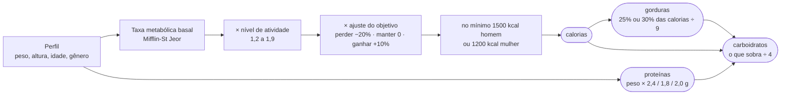
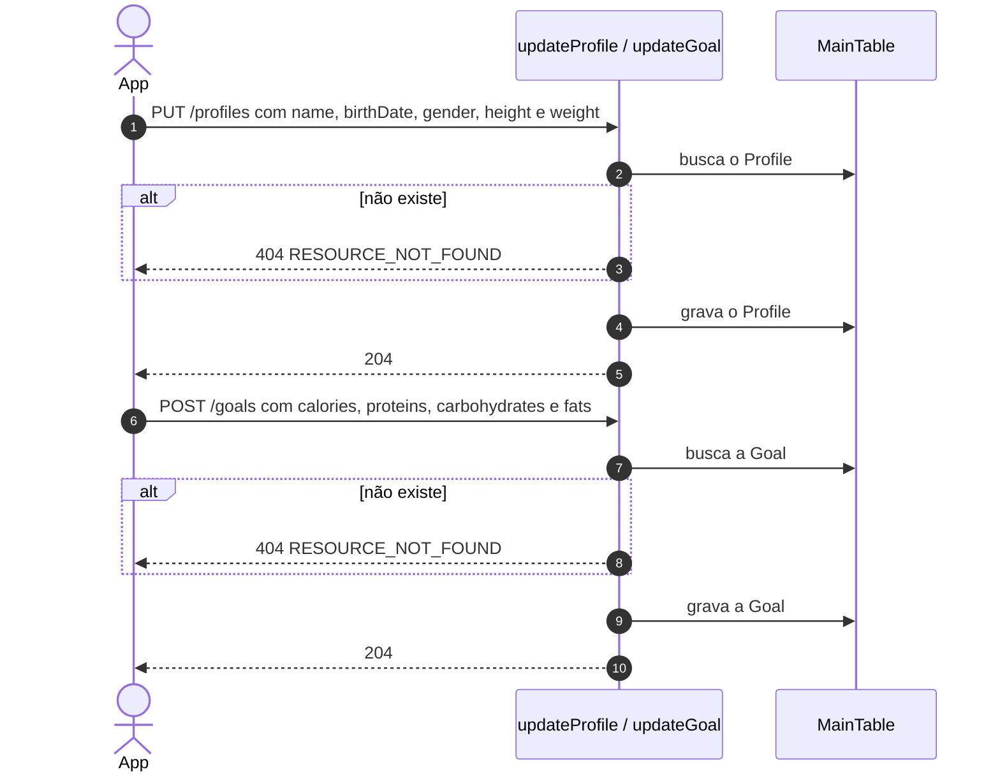

# Fluxo: perfil e meta diária

## Resumo

O perfil (nome, nascimento, gênero, altura, peso, nível de atividade e objetivo) é preenchido no onboarding e serve para calcular a **meta diária** de calorias e macros. A meta é calculada na criação da conta (e de novo se o `complete-onboarding` for chamado outra vez, ver [Google](auth-google-oauth.md#onboarding-post-authcomplete-onboarding)). Fora isso, perfil e meta são editados separadamente: mudar o peso no perfil **não** recalcula a meta.

| Ação | Rota 🔒 | Lambda | Resposta |
|---|---|---|---|
| Ver perfil, meta, plano e cotas | `GET /me` | `me` | `200` |
| Editar perfil | `PUT /profiles` | `updateProfile` | `204` |
| Editar meta | `POST /goals` | `updateGoal` | `204` |

## Cálculo da meta (`GoalCalculator`)

| Entrada | Valores |
|---|---|
| Taxa basal | Homem: `10·peso + 6,25·altura − 5·idade + 5`. Mulher: o mesmo com `− 161` no lugar do `+ 5`. |
| Nível de atividade | `SENDENTARY` 1,2 · `LIGHT` 1,375 · `MODERATE` 1,55 · `HEAVY` 1,725 · `ATHELETE` 1,9 |
| Proteína por kg | `LOSE` 2,4 · `MAINTAIN` 1,8 · `GAIN` 2,0 |
| Gordura (fração das calorias) | `LOSE` 0,25 · `MAINTAIN` 0,30 · `GAIN` 0,25 |

> `SENDENTARY` e `ATHELETE` estão escritos assim no código e no contrato com o app. Corrigir a grafia exige migrar os dados gravados e mudar o app junto.

Onde a meta é calculada:

- no cadastro por e-mail, quando o `PendingSignUp` é aplicado ([cadastro](auth-cadastro-email.md));
- no `complete-onboarding` do login com Google ([Google](auth-google-oauth.md)).

As duas gravações só acontecem enquanto a conta não está onboarded (o `Put` da `Account` no `SignUpUOW` tem condição). Um `complete-onboarding` numa conta já onboarded responde `204` sem gravar, então não desfaz edições feitas por `PUT /profiles` e `POST /goals`.

## Edição

- `PUT /profiles` **não** altera `activityLevel` nem `goal`: eles só entram no cálculo inicial.
- `POST /goals` aceita qualquer valor positivo. Se o app quiser oferecer "recalcular a meta", hoje o cálculo teria que ser feito no app ou exposto numa rota nova.

## `GET /me`

Uma única `Query` na partição `ACCOUNT#<accountId>` traz `Account`, `Profile`, `Goal` e `Subscription` de uma vez (ver [modelo de dados](../03-modelo-de-dados.md)). Depois a API calcula o plano efetivo e lê o uso da cota. A resposta tem `isOnboarded`, `email`, `profile`, `goal`, `subscription` (com `plan` já resolvido), `mealQuota` e `dailyMealQuota`. Se a `Account` não existir, o `GET /me` cria (ver [login](auth-login-senha.md#login-e-primeiro-get-me)).

## Erros

| Situação | Resposta |
|---|---|
| Corpo fora do schema | `400 VALIDATION` |
| Perfil ou meta não existe (conta sem onboarding) | `404 RESOURCE_NOT_FOUND` |

## Arquivos envolvidos

| Etapa | Arquivo |
|---|---|
| Cálculo da meta | [`GoalCalculator.ts`](../../../src/application/services/GoalCalculator.ts) |
| Perfil | [`UpdateProfileUseCase.ts`](../../../src/application/useCases/profile/UpdateProfileUseCase.ts), [`updateProfileSchema.ts`](../../../src/application/controllers/profiles/schemas/updateProfileSchema.ts) |
| Meta | [`UpdateGoalUseCase.ts`](../../../src/application/useCases/goal/UpdateGoalUseCase.ts), [`updateGoalSchema.ts`](../../../src/application/controllers/goal/schemas/updateGoalSchema.ts) |
| `GET /me` | [`GetMeController.ts`](../../../src/application/controllers/accounts/GetMeController.ts), [`GetProfileAndGoalByAccountId.ts`](../../../src/application/query/GetProfileAndGoalByAccountId.ts) |
| Entidades | [`Profile.ts`](../../../src/application/entities/Profile.ts), [`Goal.ts`](../../../src/application/entities/Goal.ts) |
