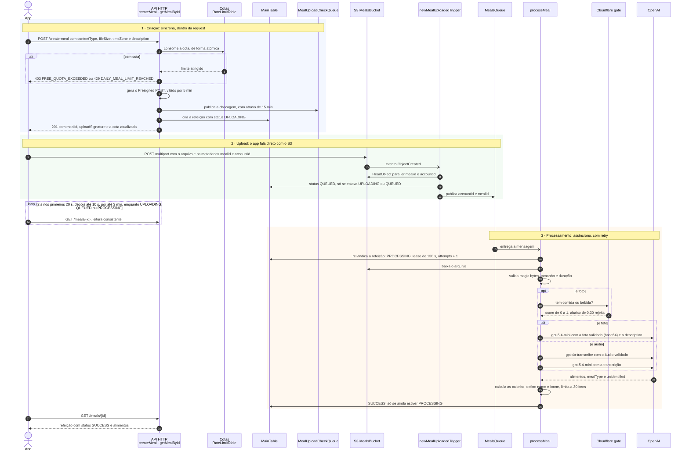
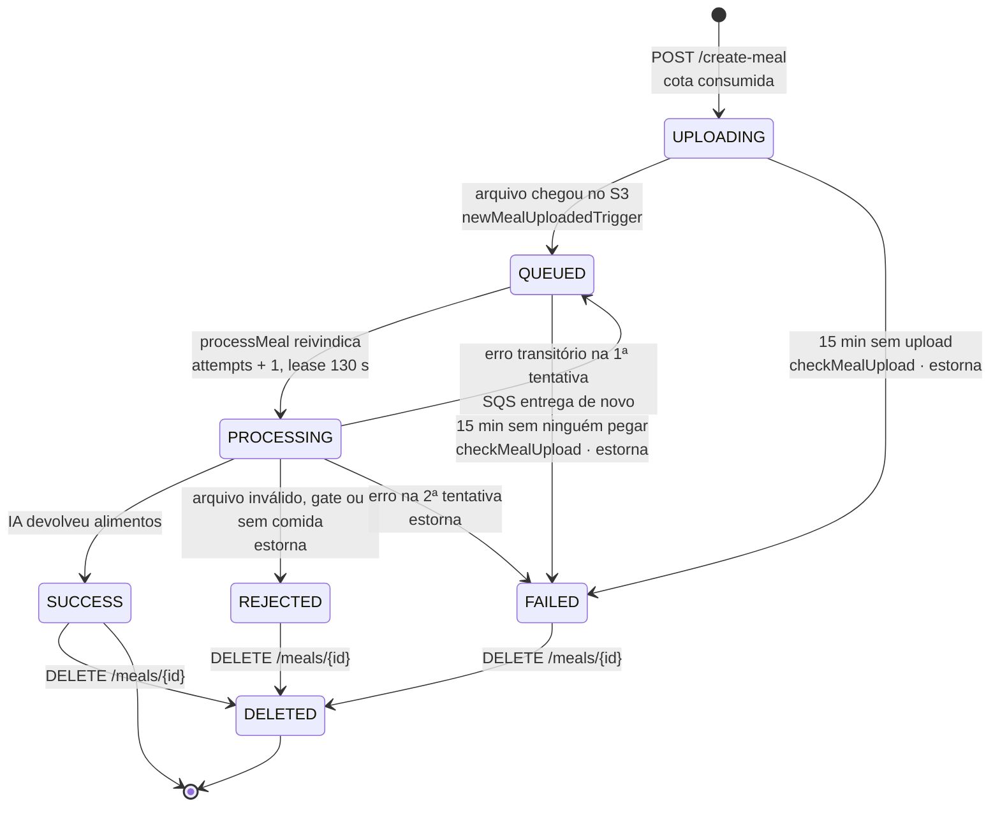
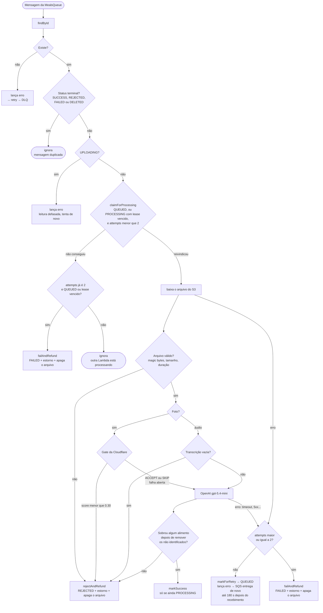
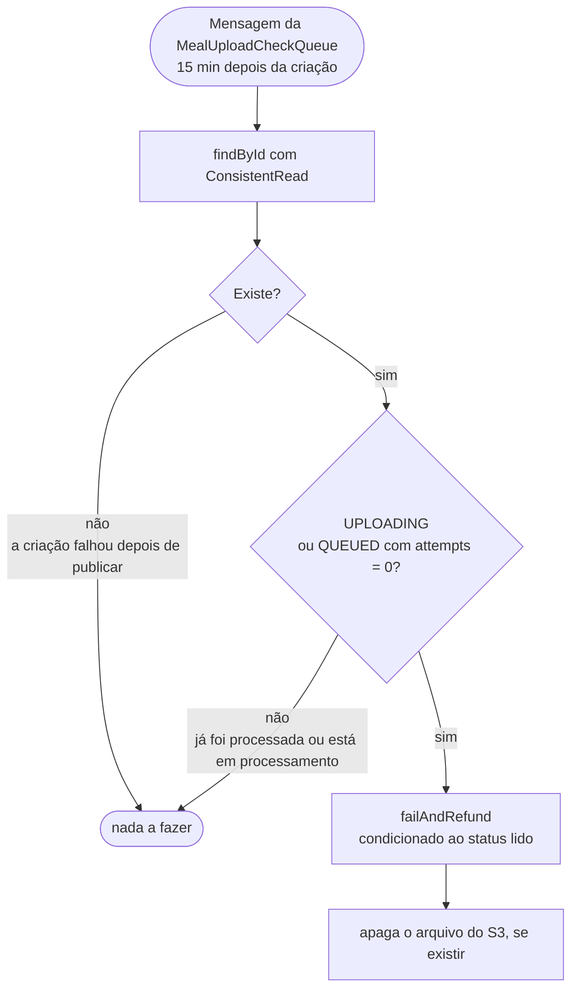

# Fluxo: refeição por foto ou áudio

## Resumo

O app pede à API uma autorização de upload, manda o arquivo **direto para o S3** e fica consultando a refeição até ela terminar. O upload dispara uma fila, e uma Lambda valida o arquivo, passa a foto pelo gate da Cloudflare, manda o conteúdo para a OpenAI e grava os alimentos. A cota é consumida **no início**. Se a refeição não chegar a `SUCCESS` (rejeitada, falhou ou travou), a cota é **devolvida**.

| | |
|---|---|
| **Entrada** | `POST /create-meal` 🔒 |
| **Acompanhamento** | `GET /meals/{id}` 🔒, polling enquanto o status está em andamento: 2 s nos primeiros 20 s, depois intervalo crescente até 10 s, e para em 3 min |
| **Lambdas** | `createMeal` → `newMealUploadedTrigger` → `processMeal` (+ `checkMealUpload` após 15 min) |
| **Tipos aceitos** | `image/jpeg` (até 2 MB, maior lado até 4096 px e até 16 MP) · `audio/m4a` e `audio/webm` (até 2 MB, de 1 a 32 s) |
| **Rate limit** | 10 criações por hora por conta |
| **Teto de estornos** | 5 rejeições estornadas por dia por conta (fuso de São Paulo); da 6ª em diante, a rejeição fica com a cota |

## Visão de ponta a ponta

## Estados da refeição

| Status | Significado | O app mostra | Cota |
|---|---|---|---|
| `UPLOADING` | Refeição criada, esperando o arquivo chegar ao S3 | "Processando" | Consumida |
| `QUEUED` | Arquivo no S3, mensagem na fila | "Processando" | Consumida |
| `PROCESSING` | Uma Lambda está processando, com lease | "Processando" | Consumida |
| `SUCCESS` | Alimentos gravados | A refeição | Consumida |
| `REJECTED` | Não é refeição, arquivo inválido ou sem alimentos (`rejectionReason`) | Mensagem conforme o motivo | **Estornada** |
| `FAILED` | Erro técnico ou upload que travou | Mensagem de erro | **Estornada** |
| `DELETED` | Excluída pelo usuário (some das listagens) | Nada | Não volta |

Uma refeição `SUCCESS` excluída **não devolve** a cota: a IA já foi usada.

## Decisões dentro do `processMeal`

## Passo a passo

### 1. Criação (`POST /create-meal`)

1. O `@Schema(createMealSchema)` valida o corpo: `contentType` é um dos 3 MIME types, `fileSize` tem até 2 MB (foto e áudio), `description` tem até 300 caracteres e **só é aceita para foto**.
2. O `CreateMealUseCase` descobre o plano efetivo (`Subscription.resolveEffectivePlan`) e **consome a cota** no `MealQuotaService` com um incremento condicional na `RateLimitTable`:
   - **Free**: contador mensal `RL#account-monthly#<accountId>` / `AAAA-MM`, limite 20.
   - **Pro**: contador diário no fuso de São Paulo, limite 20, mais um contador mensal com sufixo `#PRO` (sem limite, só para contar).
3. Gera a chave do arquivo (`<accountId>/<uuid>.<ext>`) e o **Presigned POST**, que só aceita aquele `Content-Type`, **exatamente** aquele `fileSize` e aquela chave. Os campos `x-amz-meta-mealid` e `x-amz-meta-accountid` também têm **valor fixo** (condição exata): quem tem a autorização não consegue apontar o upload para a refeição de outra conta. Expira em 5 minutos.
4. Publica na `MealUploadCheckQueue` com `DelaySeconds: 900`. É a rede de segurança da [refeição presa](#refeição-presa-checagem-de-15-min).
5. Grava a refeição com `status: UPLOADING`, guardando `quotaMonth` e `quotaDay` para saber o que estornar depois.
6. Se qualquer passo de 3 a 5 falhar, a cota é estornada e a resposta é `500`.

Resposta `201`: `{ mealId, uploadSignature, mealQuota, dailyMealQuota }`. O `uploadSignature` é o Presigned POST (URL + campos) em base64. `mealQuota` e `dailyMealQuota` têm o mesmo formato do `GET /me` (`{ used, limit, remaining }`; `dailyMealQuota` é `null` no Free) e saem dos próprios incrementos do `consume` (`ReturnValues: UPDATED_NEW`), sem leitura a mais. O app atualiza a cota em cache (`setQueryData(['accounts'])`) em vez de refazer o `GET /me`.

### 2. Upload e enfileiramento (`newMealUploadedTrigger`)

1. O app faz um `POST` multipart para o S3 com os campos do `uploadSignature` e o arquivo.
2. O S3 dispara `ObjectCreated`. A Lambda lê os metadados com `HeadObject`, porque a chave do arquivo não carrega o `mealId`.
3. Se a refeição não existe (por exemplo, a criação falhou depois de gerar o Presigned POST) ou o arquivo não é o `inputFileKey` dela, só registra um `warn` e termina, sem enfileirar.
4. `markQueued`: muda para `QUEUED` **só se** o status for `UPLOADING` ou `QUEUED`. Se a refeição já seguiu adiante, não faz nada.
5. Publica `{ accountId, mealId }` na `MealsQueue`.

**Falhas são relançadas.** Se o `HeadObject`, o `markQueued` ou a publicação falharem, o adapter de S3 registra `s3 event failed` e lança o erro. A invocação do S3 é assíncrona, então o Lambda repete o evento até 2 vezes (cerca de 1 e 2 minutos depois). Repetir é seguro: `markQueued` devolve `true` tanto em `UPLOADING` quanto em `QUEUED`, então a nova tentativa publica de novo. Uma mensagem duplicada costuma ser ignorada pelo `claimForProcessing`; no caso raro de a primeira publicação ter chegado à fila (timeout do SDK com a mensagem entregue) e a primeira tentativa de processamento ter devolvido a refeição para `QUEUED`, a duplicada pode gastar uma das 2 tentativas. Se as 3 tentativas falharem, o evento se perde (não há fila de falhas, e a `MealsDLQ` só recebe mensagens que já estavam na `MealsQueue`). O `NewMealUploadedTriggerErrorsAlarm` avisa, e a refeição é recuperada pela checagem de 15 minutos: fica em `UPLOADING` ou em `QUEUED` com `attempts = 0`, é marcada `FAILED` e estornada. Ela não reprocessa.

### 3. Processamento (`processMeal`)

**Reivindicação com lease.** `claimForProcessing` é um `UpdateItem` condicional: passa para `PROCESSING`, grava `leaseExpiresAt = agora + 130 s` e soma 1 em `attempts`, **só se** a refeição estiver `QUEUED` (ou `PROCESSING` com o lease vencido) e com `attempts < 2`. Isso impede duas Lambdas de processarem a mesma refeição quando o SQS entrega a mensagem duas vezes.

**Validação do arquivo** (`MealFileValidationService`): confere a assinatura real do arquivo (magic bytes), não a extensão. Para foto, JPEG de verdade (`FF D8 FF`), até 2 MB, maior lado até 4096 px e até 16 MP (o app converte outros formatos para JPEG e reduz o maior lado para 1024 px antes do upload). Com esses limites, toda foto válida cabe no gate. Para áudio, tamanho e duração de 1 a 32 s, lida com o `music-metadata`. O WebM gravado pelo Safari (iPhone e Mac) não traz a duração no cabeçalho, então ela é calculada pelo timecode do último bloco (`src/shared/utils/getWebmDurationSeconds.ts`). Arquivo inválido vira `REJECTED` com `INVALID_FILE`.

**Gate de foto** (`MealGateGateway`): manda a imagem ao modelo `clef-flash` da Cloudflare, com timeout de 8 s. Score abaixo de `MEAL_GATE_REJECT_THRESHOLD` (0.30) vira `REJECTED` com `NOT_A_MEAL`. **Falha aberta**: se o gate estiver desligado, sem credenciais, com a imagem grande demais (mais de 4 MB ou 16 MP), com erro HTTP, com resposta inválida ou com timeout, a decisão é `SKIP` e a foto segue para a OpenAI.

Configuração do gate: `CLOUDFLARE_ACCOUNT_ID` e `CLOUDFLARE_AI_API_TOKEN` (token com permissão `Workers AI`), `MEAL_GATE_ENABLED` e `MEAL_GATE_REJECT_THRESHOLD`. Valor inválido em `MEAL_GATE_ENABLED` desliga o gate. Em `MEAL_GATE_REJECT_THRESHOLD`, volta para `0.30`. Os dois casos geram um aviso no log.

**IA** (`MealAiGateway`):

- **Foto**: o `gpt-5.4-mini` recebe **o mesmo buffer que foi validado**, em base64 (`data:image/jpeg;base64,...`), e não a URL da CDN: o arquivo não pode ser trocado entre a validação e a leitura, e um cache antigo da CDN não entra na análise. Com `detail: high`, a OpenAI reescala a imagem, então uma foto maior não custa mais tokens. Se existir, a `description` vai dentro de `<user_note>`, com `<` e `>` neutralizados para a nota ser tratada como dado, não como instrução.
- **Áudio**: o buffer já validado é transcrito pelo `gpt-4o-transcribe` (sem baixar de novo pela CDN) e a transcrição vai para o `gpt-5.4-mini` com o prompt de texto (variante de áudio). Transcrição vazia vira `REJECTED` com `NO_FOOD_DETECTED`.
- A saída é estruturada (zod): alimentos com nome, quantidade e macros, o `mealType` declarado e o `unidentified`. Alimentos marcados como não identificados são removidos (log `unidentified foods removed`). Na foto, um `unidentified: DRINK` é descartado quando a descrição já cita uma bebida que entrou nos alimentos (quantidade em ml e uma palavra do nome presente na descrição; log `unidentified drink explained by note`). Se não sobrar nenhum, vira `REJECTED` com `NO_FOOD_DETECTED`.
- **Tempos**: todo o trabalho da OpenAI de uma refeição (transcrição e análise, com os retries) tem um **prazo único de 90 s**, passado como `signal` a cada chamada. Dentro dele: análise com timeout de 45 s e 1 retry, transcrição com 30 s e 1 retry. Somados à leitura do S3 e ao gate (até 8 s), cabem nos 120 s da Lambda com folga para gravar o resultado. O prazo também corta a espera de um `Retry-After` longo da OpenAI (o SDK obedece o header sem limite e a espera não olha o `signal`, então cada chamada corre contra o prazo num `Promise.race`). Estourou o prazo: a chamada é abortada e a refeição segue o caminho de erro (retry ou `FAILED` com estorno), em vez de a Lambda morrer sem marcar nada.
- **Parâmetros**: `store: false` (a OpenAI não guarda a resposta; ela não aparece nos logs do painel da OpenAI), `reasoning.effort: none` explícito (é o padrão do `gpt-5.4-mini`; fixado para não mudar se o padrão mudar; `low` foi testado na foto e piorou: mais itens omitidos, 2,4× a latência e 3× os tokens de saída) e `max_output_tokens: 2048`, que inclui os tokens de raciocínio. O array `foods` dos três schemas tem `maxItems: 30` (`Meal.MAX_FOODS`), então a OpenAI nunca devolve mais de 30 itens: no pior caso medido (48 itens pedidos), 30 itens deram ~1.100–1.200 tokens de saída, e o uso normal fica abaixo de 300. Resposta cortada (`status: incomplete`, ex.: `max_output_tokens`) vira erro e segue o mesmo caminho de erro. Texto e "adicionar itens" usam os mesmos parâmetros, com timeout de 18 s, 1 retry e prazo total de 25 s (a Lambda tem 29 s); a lista de 30 itens leva ~5–10 s.
- **Cache de prompt**: automático (o prompt fixo vai antes do conteúdo variável e passa de 1.024 tokens na foto, no áudio e no texto; o do "adicionar itens" fica abaixo e nunca entra no cache). Sem `prompt_cache_key`: no tráfego atual a falta de cache vem da expiração (5–10 min sem uso), que a chave não resolve, e a chave muda o roteamento (a primeira chamada com chave nova perde o cache já aquecido). Sem `prompt_cache_retention`: a resposta já vem com `24h` por padrão (conta sem ZDR), e no teste de 2026-11-17 o cache sumiu em 20 min com `24h`, `in_memory` ou o padrão, igual nos três.
- **Uso**: cada chamada loga `openai response` com `mealId`, `operation` (`PICTURE`, `AUDIO`, `TEXT` ou `ADD_ITEMS`), `responseStatus`, `durationMs` e `usage` (`inputTokens`, `cachedTokens`, `outputTokens`, `reasoningTokens`, `totalTokens`). A transcrição loga `openai transcription` com o `usage` devolvido pela OpenAI.

**Gravação**: calorias calculadas pela API (`4·carboidratos + 4·proteínas + 9·gorduras`), não pela IA. Nome e ícone vêm do `MealNamingService` (ver [nome e ícone](#nome-e-ícone-da-refeição)). No máximo 30 itens. `markSuccess` só grava se o status ainda for `PROCESSING`.

### Nome e ícone da refeição

A IA **não** escolhe o nome. A API usa o horário da criação no fuso do usuário (`timeZone` IANA enviado na criação; inválido ou ausente cai em `America/Sao_Paulo`). Quando o usuário **declara** a refeição ("almocei", "foi meu jantar") no áudio, no texto ou na descrição da foto, a IA devolve um `mealType`, que tem prioridade sobre o horário. Menção genérica ou negada vem `null`.

| Horário local | Nome | Ícone | `mealType` |
|---|---|---|---|
| 04:00–10:59 | Café da manhã | ☕ | `BREAKFAST` |
| 11:00–14:59 | Almoço | 🍽️ | `LUNCH` |
| 15:00–17:59 | Lanche da tarde | 🍎 | `AFTERNOON_SNACK` |
| 18:00–22:59 | Jantar | 🍲 | `DINNER` |
| 23:00–03:59 | Ceia | 🌙 | `SUPPER` |

O mesmo fuso define o **dia** da refeição no `GSI1PK`. Os dois cálculos usam `src/shared/utils/timeZone.ts`, então nome e dia nunca divergem. O mesmo vale para a refeição por texto.

### 4. Acompanhamento (`GET /meals/{id}`)

O app consulta enquanto o status for `UPLOADING`, `QUEUED` ou `PROCESSING` (`app/src/app/hooks/queries/useGetMealById.ts`), contando o tempo a partir do fim do upload: a cada 2 s nos primeiros 20 s, depois com o intervalo multiplicado por 1,5 até 10 s (3 s, 4,5 s, 6,75 s, 10 s...), e para em 3 min. A leitura é consistente (`ConsistentRead`), para não mostrar um status antigo.

- **Caso normal**: a `processMeal` leva 3,5 s (p50) e 5,3 s (p90) (medido em 2026-11-17), então são 3 a 5 consultas por refeição.
- **Refeição presa**: no máximo ~28 consultas em 3 min. Antes, o polling a cada 3 s não tinha limite e o loader de tela cheia prendia o usuário até o `FAILED` da checagem de 15 min (até ~300 consultas).
- **No limite**: o app faz uma última consulta (o timer dos 3 min corre mesmo com a aba oculta ou o app em segundo plano, quando o polling fica parado) e, se a refeição terminou, segue o fluxo normal. Se ainda estiver em andamento, o modal fecha com o toast "Sua refeição está demorando mais que o normal. Ela vai aparecer na sua lista assim que ficar pronta." e a lista do dia e a query da refeição são marcadas como desatualizadas sem nova busca (`invalidateQueries` com `refetchType: 'none'`). A marca da lista sobrevive a uma inserção posterior no cache (`insertMealIntoDayList` a refaz). Ela é buscada de novo quando o app volta ao foco (web) ou no gesto de puxar (nativo). Se a refeição terminar em `FAILED` depois disso, a cota é estornada no servidor e nada aparece na lista.
- **No `SUCCESS`**: o app insere a refeição na lista do dia em cache (`insertMealIntoDayList`, ordenada por `createdAt`), sem refazer o `GET /meals`. A lista só traz refeições em `SUCCESS`.

## Retry, lease e estorno

O desenho junta três números que dependem uns dos outros:

```mermaid
gantt
    title Uma entrega da MealsQueue
    dateFormat ss
    axisFormat %M:%S
    section Lambda
    timeout do processMeal (120 s)        :a1, 00, 120s
    section DynamoDB
    lease da refeição (130 s)             :a2, 00, 130s
    section SQS
    visibility timeout (180 s)            :a3, 00, 180s
```

| Constante | Valor | Onde | Regra |
|---|---|---|---|
| Timeout do `processMeal` | 120 s | `sls/functions/meal.yml` | Menor que o lease |
| `Meal.PROCESSING_LEASE_SECONDS` | 130 s | `Meal.ts` | Maior que o timeout e menor que a visibilidade |
| `VisibilityTimeout` da `MealsQueue` | 180 s | `sls/resources/mealsQueue.yml` | Maior que o lease: quando a mensagem volta, o lease já venceu |
| `Meal.MAX_ATTEMPTS` | 2 | `Meal.ts` | Menor que o `maxReceiveCount` |
| `maxReceiveCount` | 3 | `mealsQueue.yml` | Sobra 1 entrega só para limpeza |
| `Meal.UPLOAD_CHECK_DELAY_SECONDS` | 900 s | `Meal.ts` | Máximo do SQS. Bem maior que os 5 min do Presigned POST |

**Por que três entregas para duas tentativas?** Se a Lambda morrer no meio da 2ª tentativa (timeout ou falta de memória), ninguém marca `FAILED`. A 3ª entrega encontra `attempts = 2` e o lease vencido e chama `failAndRefund`. Se a 3ª entrega também falhar, a mensagem vai para a `MealsDLQ` e, em prod, o alarme manda e-mail.

**Estorno atômico.** `failAndRefund` e `rejectAndRefund` usam uma `TransactWriteItems` que, juntos, mudam o status da refeição (condicionado ao status lido) e decrementam os contadores de cota (mês e, no Pro, dia), no bucket gravado na refeição, mesmo que o estorno aconteça no dia seguinte. O `ClientRequestToken` (`<mealId>#fail#<attempts>`, `<mealId>#reject#<attempts>` ou `<mealId>#upload` para a refeição presa em `UPLOADING`) torna a transação idempotente sem colidir com outra operação da mesma refeição. O DynamoDB aceita até 36 caracteres nesse token. A flag `quotaRefunded` registra se o estorno aconteceu: se o contador já estiver zerado, a refeição muda de status sem estorno.

**Teto de rejeições estornadas.** A transação do `rejectAndRefund` também soma 1 no contador `RL#account-rejections#<accountId>` / `AAAA-MM-DD` (dia de São Paulo, TTL de 15 dias), com a condição `count < 5` (`MealQuotaService.DAILY_REFUNDED_REJECTIONS_LIMIT`). Na 6ª rejeição do dia a condição falha, a transação é cancelada e o `markRejected` grava `REJECTED` com `quotaRefunded: false`: a refeição fica com a cota. Vale para Free e Pro e para todos os motivos (`NOT_A_MEAL`, `NO_FOOD_DETECTED`, `INVALID_FILE`). Não há erro novo nem texto novo no app: o usuário vê a mesma mensagem de rejeição, e a cota mostrada na Home já reflete o consumo. Sem o teto, um Free com 1 refeição de saldo conseguia repetir 10 tentativas por hora (cerca de 240 por dia) sem gastar cota, cada uma com o gate e, se passasse, uma chamada de visão. Agora o máximo por dia é 5 mais a cota que ainda resta. O `meal rejected` loga `refunded`. A falha (`FAILED`) continua sempre estornada e não entra no contador. O texto e o adicionar itens não entram: não consomem cota quando não acham alimento, mas são chamadas de texto (baratas) com limite por hora.

**Concorrência limitada.** O evento SQS tem `maximumConcurrency: 5`: no máximo 5 execuções da `processMeal` ao mesmo tempo (até 10 refeições, com o lote de 2). Numa rajada, o resto espera na fila sem ser recebido, então o `VisibilityTimeout` e o lease não andam enquanto esperam, e a OpenAI não recebe dezenas de chamadas em paralelo (cada foto tem ~4,5 mil tokens de entrada; o 429 viraria retry e depois `FAILED`). Uma fila maior que ~20 refeições pode passar dos 2 min e disparar o `MealsQueueAgeAlarm`, que é o sinal de que o limite precisa subir. O `maximumConcurrency` não gera throttle da Lambda (o `ProcessMealThrottlesAlarm` continua só para o limite da conta).

**Lote de 2 com retorno parcial.** A `processMeal` recebe até 2 mensagens por vez. O `lambdaSQSAdapter` processa as duas com `Promise.allSettled` e espera as duas terminarem; as que lançaram erro vão no `batchItemFailures` (o evento usa `functionResponseType: ReportBatchItemFailures`) e só elas voltam para a fila, depois do `VisibilityTimeout`. A outra é apagada normalmente. O erro de cada mensagem vai para o log (`sqs message failed`, com `messageId` e `receiveCount`). O `checkMealUpload` usa o mesmo adapter, com lotes de até 10. Como o adapter não lança, o `Errors` da Lambda fica zerado: a falha que importa é medida pela métrica `MealFailed` (abaixo).

**Logs e métrica.** Cada mensagem tem as linhas JSON `meal processing started` (com `inputType` e `attempt`), `meal processed`, `meal rejected` ou `meal processing attempt failed`, todas com `mealId`, `accountId`, `messageId` e `awsRequestId`. Toda vez que uma refeição vira `FAILED` (2ª tentativa com erro, lease vencido na 3ª entrega ou upload preso na checagem de 15 min) sai a métrica EMF `MealFailed` (namespace `NaCal`), com `source` = `attemptsExhausted`, `leaseExpired` ou `uploadStalled`. Em prod, o `MealFailedAlarm` manda e-mail. A métrica conta eventos, não refeições distintas: uma reentrega da mesma mensagem logo depois pode contar a mesma refeição duas vezes (o `failAndRefund` é idempotente e devolve sucesso nas duas).

**Limitações conhecidas:**
- **Lease sem fencing completo.** Só o `markForRetry` confere o `leaseExpiresAt`. `markSuccess` e `rejectAndRefund` só exigem `status = PROCESSING`. Hoje o risco é teórico, porque o timeout (120 s) é menor que o lease (130 s). Volta a importar se esses números mudarem.
- **TTL dos contadores de cota.** O mensal expira 7 dias depois da virada e o diário em 15 dias. Um estorno depois disso muda o status sem estornar (`quotaRefunded: false`). Na prática não acontece, porque o estorno vem em minutos.
- **Arquivos órfãos.** Apagar o arquivo do S3 é melhor esforço (a falha só vai para o log), e o bucket não tem lifecycle rule.

## Refeição presa (checagem de 15 min)

A mensagem publicada na criação fica invisível por 15 minutos e então cai no `checkMealUpload`:

Quando ela atua:

- **`UPLOADING`**: o app nunca mandou o arquivo (fechou, perdeu a rede ou o Presigned POST expirou) ou o evento do S3 falhou nas 3 tentativas.
- **`QUEUED` com `attempts = 0`**: o arquivo chegou, mas a publicação na `MealsQueue` falhou, ou a fila está atrasada há mais de 10 minutos (o alarme `MealsQueueAgeAlarm` avisa bem antes, quando a mensagem mais antiga passa de 2 minutos).

A escrita é condicional ao status lido, então um upload que termina no último segundo **não** é estornado por engano.

## Erros e casos de borda

| Situação | Resultado | Cota |
|---|---|---|
| Free sem refeições no mês | `403 FREE_QUOTA_EXCEEDED` | Não consome |
| Pro com 20 refeições no dia | `429 DAILY_MEAL_LIMIT_REACHED` | Não consome |
| Mais de 10 criações na hora | `429 RATE_LIMIT_EXCEEDED` + `Retry-After` | Não consome |
| Corpo inválido (tipo, tamanho, `description` em áudio) | `400 VALIDATION` | Não consome |
| Falha ao gerar o upload, publicar ou gravar | `500` | Estornada na hora |
| Arquivo de tamanho diferente do declarado | O S3 recusa o upload, a refeição fica `UPLOADING` | Estornada em 15 min |
| Metadado (`mealid`, `accountid`) diferente do assinado | O S3 recusa o upload (`403`), a refeição fica `UPLOADING` | Estornada em 15 min |
| Arquivo corrompido ou de outro formato | `REJECTED` / `INVALID_FILE` | Estornada |
| Foto sem comida | `REJECTED` / `NOT_A_MEAL` (com `gateScore`) | Estornada |
| Áudio sem fala ou sem alimento | `REJECTED` / `NO_FOOD_DETECTED` | Estornada |
| OpenAI fora do ar duas vezes | `FAILED` | Estornada |
| Cloudflare fora do ar | Segue sem o gate (falha aberta) | — |
| Mensagem duplicada do SQS | Ignorada (status terminal ou lease ativo) | — |

Em toda rejeição ou falha, o arquivo é apagado do S3.

## Arquivos envolvidos

| Etapa | Arquivo |
|---|---|
| Rota e config das Lambdas | [`sls/functions/meal.yml`](../../../sls/functions/meal.yml) |
| Filas, DLQs e alarmes | [`sls/resources/mealsQueue.yml`](../../../sls/resources/mealsQueue.yml), [`sls/resources/mealUploadCheckQueue.yml`](../../../sls/resources/mealUploadCheckQueue.yml) |
| Validação do corpo | [`createMealSchema.ts`](../../../src/application/controllers/meal/schemas/createMealSchema.ts) |
| Controller | [`CreateMealController.ts`](../../../src/application/controllers/meal/CreateMealController.ts) |
| Criação | [`CreateMealUseCase.ts`](../../../src/application/useCases/meal/CreateMealUseCase.ts) |
| Cotas | [`MealQuotaService.ts`](../../../src/application/services/MealQuotaService.ts) |
| Presigned POST, CDN e S3 | [`MealFileStorageGateway.ts`](../../../src/infra/gateways/MealFileStorageGateway.ts) |
| Evento do S3 | [`MealUploadedEventHandler.ts`](../../../src/application/events/MealUploadedEventHandler.ts) → [`MealUploadedUseCase.ts`](../../../src/application/useCases/meal/MealUploadedUseCase.ts) |
| Consumidor da fila | [`MealQueueConsumer.ts`](../../../src/application/queues/MealQueueConsumer.ts) → [`ProcessMealUseCase.ts`](../../../src/application/useCases/meal/ProcessMealUseCase.ts) |
| Validação do arquivo | [`MealFileValidationService.ts`](../../../src/application/services/MealFileValidationService.ts) |
| Gate | [`MealGateGateway.ts`](../../../src/infra/ai/gateways/MealGateGateway.ts) |
| IA e prompts | [`MealAiGateway.ts`](../../../src/infra/ai/gateways/MealAiGateway.ts), [`prompts/`](../../../src/infra/ai/prompts/) |
| Nome e ícone | [`MealNamingService.ts`](../../../src/application/services/MealNamingService.ts) |
| Estados, lease e estorno | [`Meal.ts`](../../../src/application/entities/Meal.ts), [`MealRepository.ts`](../../../src/infra/databases/dynamodb/MealRepository.ts) |
| Refeição presa | [`MealUploadCheckQueueConsumer.ts`](../../../src/application/queues/MealUploadCheckQueueConsumer.ts) → [`CheckMealUploadUseCase.ts`](../../../src/application/useCases/meal/CheckMealUploadUseCase.ts) |
| Polling no app | `app/src/app/hooks/queries/useGetMealById.ts` (repo do app) |

