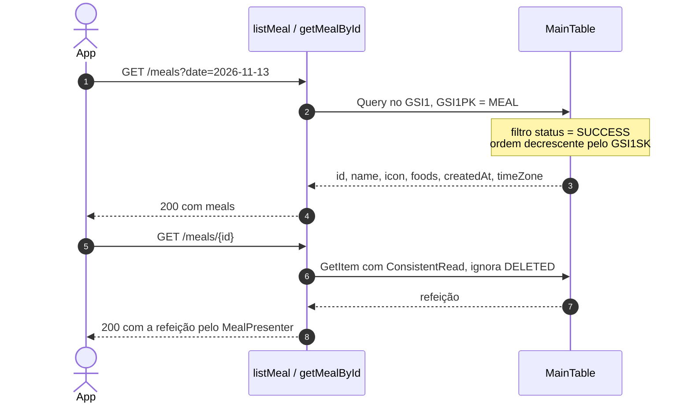
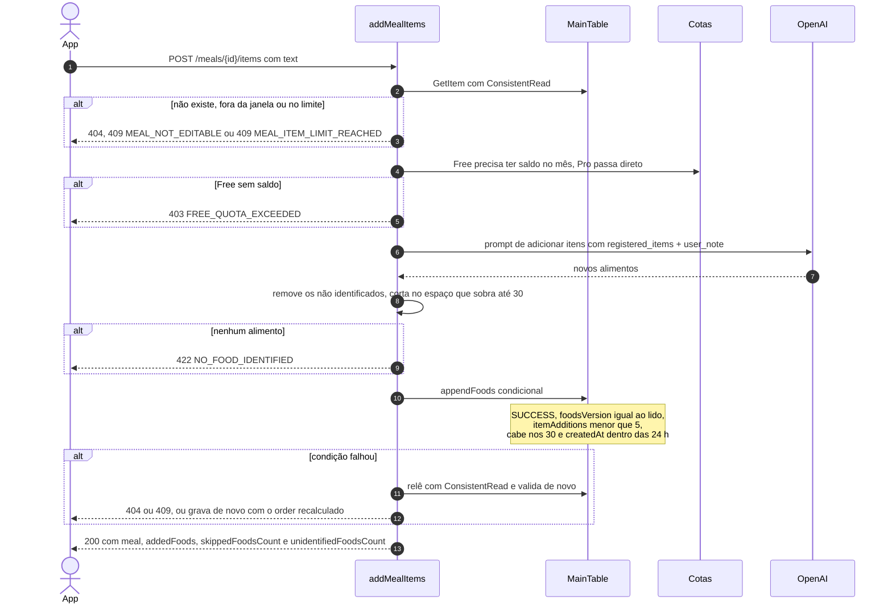
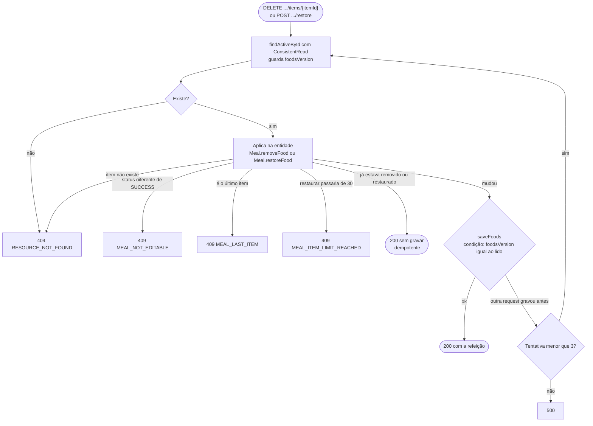

# Fluxo: consultar, editar e excluir refeições

## Resumo

Depois que a refeição chega a `SUCCESS`, o usuário pode **listar** as refeições do dia, **adicionar itens** por texto (com IA), **remover** e **restaurar** itens, e **excluir** a refeição. Todas as edições usam escrita condicional no DynamoDB, para duas requests simultâneas não sobrescreverem uma à outra.

| Ação | Rota 🔒 | Lambda | Rate limit por conta |
|---|---|---|---|
| Listar o dia | `GET /meals?date=AAAA-MM-DD` | `listMeal` | — |
| Ver uma | `GET /meals/{id}` | `getMealById` | — |
| Adicionar itens | `POST /meals/{id}/items` com `{ text }` (1 a 300 caracteres) | `addMealItems` (256 MB, 29 s) | 20 por hora |
| Remover item | `DELETE /meals/{id}/items/{itemId}` | `removeMealItem` | 60 por hora |
| Restaurar item | `POST /meals/{id}/items/{itemId}/restore` | `restoreMealItem` | 60 por hora |
| Excluir | `DELETE /meals/{id}` | `deleteMeal` | 30 por hora |

## Regras de edição

| Regra | Valor | Onde |
|---|---|---|
| Só refeição em `SUCCESS` é editável | — | `Meal.isEditable`, `Meal.canRemoveItems` |
| Janela para **adicionar** itens | 24 h desde a criação | `Meal.EDIT_WINDOW_HOURS` |
| Janela para **remover ou restaurar** | Sem prazo | `Meal.canRemoveItems` |
| Adições por refeição | 5 | `Meal.MAX_ITEM_ADDITIONS` |
| Itens por refeição | 30 | `Meal.MAX_FOODS` |
| Último item | Não pode ser removido | `Meal.removeFood` |
| Excluir | Só `SUCCESS`, `REJECTED` ou `FAILED` | `Meal.deletableStatuses` |

A resposta de `GET /meals/{id}` já traz `canAddItems` e `canRemoveItems`, calculados com essas regras, para o app decidir quais botões mostrar.

## Listar e ver

- **O "dia" é o dia local do usuário.** O `GSI1PK` usa a data da criação no `timeZone` enviado na criação da refeição. Uma refeição feita às 23h em São Paulo cai no dia certo, mesmo já sendo o dia seguinte em UTC.
- A listagem só traz `SUCCESS`. Refeições em processamento, rejeitadas ou com falha aparecem só pelo `GET /meals/{id}`.
- A resposta não traz URL do arquivo: o `inputFileUrl` e a CDN saíram em 2026-11-17 (o app nunca mostrou a foto). Se a foto voltar a aparecer no app, a ideia é uma URL pré-assinada de `GetObject` com validade curta, gerada pelo `MealPresenter`.

## Adicionar itens por texto

- A chamada à OpenAI é síncrona, com o mesmo timeout de 18 s, 1 retry e prazo de 25 s da [refeição por texto](refeicao-texto.md), e devolve no máximo 30 itens (`maxItems` no schema).
- A IA recebe os itens já registrados (`<registered_items>`), para não duplicar o que já está na refeição e para entender referências como "mais um desses".
- **Adicionar itens não consome cota.** O Free só precisa ter saldo, para quem esgotou a cota não usar a IA de graça por esse caminho.
- `skippedFoodsCount` diz quantos alimentos a IA devolveu mas não couberam no limite de 30. A conta parte do que a IA devolve, que já vem limitado a 30 itens contando os não identificados: num texto com mais de 30 menções, o que passou disso não aparece em `skippedFoodsCount`.
- Os itens novos levam `source: ADDED` e continuam a numeração de `order` depois do maior existente, inclusive dos removidos.
- **Duas adições ao mesmo tempo não repetem o `order`.** A leitura é consistente e o `appendFoods` confere o `foodsVersion` lido (com `attribute_not_exists` para refeição antiga, como no `saveFoods`). Se outra edição gravou no meio da chamada à IA, o `appendFoods` falha: o use case relê a refeição, valida de novo (`404`, `409 MEAL_NOT_EDITABLE` ou `409 MEAL_ITEM_LIMIT_REACHED`), recalcula `order` e o espaço que sobra e grava de novo, **sem repetir a chamada à IA** (a resposta já foi paga). São até 3 gravações; se todas perderem a corrida, a resposta é `500`. A IA viu a refeição como estava antes da outra adição, então uma adição simultânea do mesmo item pode duplicá-lo.

## Remover e restaurar itens

Remover não apaga: o item sai de `foods` e vai para `removedFoods` com `removedAt`, e pode ser restaurado na mesma posição (`order`). As duas ações usam o `MealFoodsEditService`, que faz **concorrência otimista** com `foodsVersion`:

## Excluir

1. Busca a refeição. Se não existir (ou já estiver `DELETED`), `404`.
2. Se o status não for `SUCCESS`, `REJECTED` ou `FAILED`, `409 MEAL_NOT_EDITABLE`. Não dá para excluir enquanto ela está processando.
3. `markDeleted`: muda para `DELETED` com `deletedAt`, com a condição de o status ainda ser `SUCCESS`, `REJECTED` ou `FAILED`.
4. Apaga o arquivo do S3, se houver. Uma falha aqui só vai para o log, a resposta continua `204`.

A exclusão é lógica: o item fica na tabela com `status: DELETED` e some das consultas. **A cota não volta**: a IA já foi usada.

A leitura é consistente, então a exclusão logo depois do `SUCCESS` não vê o `PROCESSING` antigo nem responde `409` por isso.

## Erros

| Situação | Resposta | Cota |
|---|---|---|
| `date` inválida na listagem, ou `text` vazio ou com mais de 300 caracteres | `400 VALIDATION` | — |
| Refeição não existe, já excluída, ou item não existe | `404 RESOURCE_NOT_FOUND` | — |
| Fora de `SUCCESS`, fora da janela de 24 h (adicionar) ou excluir durante o processamento | `409 MEAL_NOT_EDITABLE` | — |
| 5 adições já feitas, 30 itens, ou restaurar passaria de 30 | `409 MEAL_ITEM_LIMIT_REACHED` | — |
| Remover o único item | `409 MEAL_LAST_ITEM` | — |
| Free sem saldo no mês, ao adicionar | `403 FREE_QUOTA_EXCEEDED` | Não consome |
| A IA não achou alimento no texto | `422 NO_FOOD_IDENTIFIED` | Não consome |
| Rate limit da rota | `429 RATE_LIMIT_EXCEEDED` | — |
| OpenAI fora do ar ou lenta, ao adicionar | `500` | Não consome |
| Remover ou restaurar perdeu 3 vezes a corrida para outra request | `500` | — |

## Arquivos envolvidos

| Etapa | Arquivo |
|---|---|
| Regras da entidade | [`Meal.ts`](../../../src/application/entities/Meal.ts) |
| Listagem | [`ListMealsController.ts`](../../../src/application/controllers/meal/ListMealsController.ts) → [`ListMealsByAccountIdAndDay.ts`](../../../src/application/query/ListMealsByAccountIdAndDay.ts) |
| Ver uma | [`GetMealByIdUseCase.ts`](../../../src/application/useCases/meal/GetMealByIdUseCase.ts), [`MealPresenter.ts`](../../../src/application/presenters/MealPresenter.ts) |
| Adicionar itens | [`AddMealItemsUseCase.ts`](../../../src/application/useCases/meal/AddMealItemsUseCase.ts), [`getAddItemsPrompt.ts`](../../../src/infra/ai/prompts/getAddItemsPrompt.ts) |
| Remover e restaurar | [`RemoveMealItemUseCase.ts`](../../../src/application/useCases/meal/RemoveMealItemUseCase.ts), [`RestoreMealItemUseCase.ts`](../../../src/application/useCases/meal/RestoreMealItemUseCase.ts), [`MealFoodsEditService.ts`](../../../src/application/services/MealFoodsEditService.ts) |
| Excluir | [`DeleteMealUseCase.ts`](../../../src/application/useCases/meal/DeleteMealUseCase.ts) |
| Escritas condicionais | [`MealRepository.ts`](../../../src/infra/databases/dynamodb/MealRepository.ts) (`appendFoods`, `saveFoods`, `markDeleted`) |
