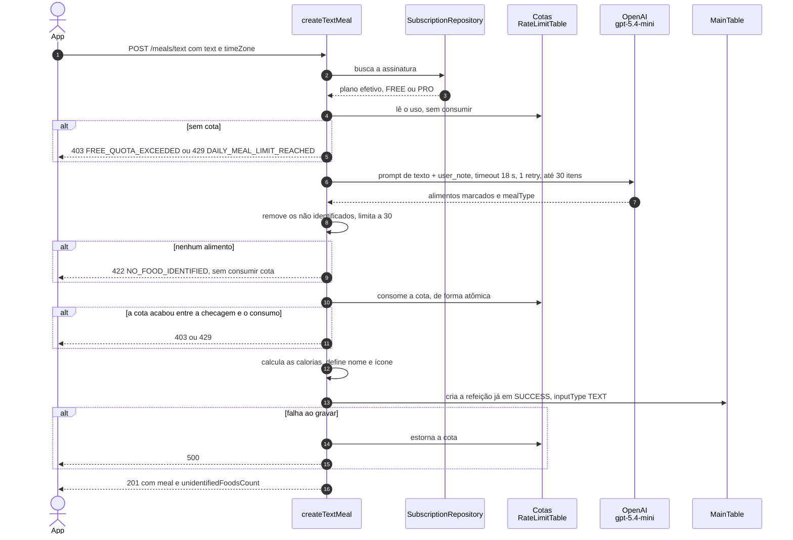

# Fluxo: refeição por texto

## Resumo

O usuário descreve a refeição por escrito ("arroz, feijão e um bife") e a API resolve tudo **dentro da própria request**: checa a cota, chama a OpenAI, grava a refeição já em `SUCCESS` e devolve a refeição pronta. Não passa por S3, SQS nem `processMeal`. Diferente da foto e do áudio, a cota só é consumida **depois** que a IA encontra algum alimento.

| | |
|---|---|
| **Entrada** | `POST /meals/text` 🔒 com `{ text, timeZone? }` |
| **Lambda** | `createTextMeal` (256 MB, timeout de 29 s, abaixo do limite de 30 s do HTTP API) |
| **Limites** | `text` de 1 a 500 caracteres · no máximo 30 itens |
| **Rate limit** | 10 por hora por conta |

## Diagrama de sequência

## Passo a passo

1. **Plano e cota.** O `CreateTextMealUseCase` resolve o plano efetivo e chama `MealQuotaService.ensureCanCreateMeal`, que só **lê** o contador: o Free precisa de saldo no mês, o Pro precisa de saldo no dia. Nada é consumido ainda.
2. **IA.** `MealAiGateway.extractMealFromText` usa o mesmo prompt do áudio (`getTextMealPrompt`, variante `TEXT`), com o texto dentro de `<user_note>` e `<` e `>` neutralizados. Por ser síncrona, a chamada tem timeout de 18 s, 1 retry e prazo total de 25 s (`syncRequestOptions`), para caber nos 29 s da Lambda. Depois de um timeout, o retry tem só ~6 s até o prazo: ele serve para erros rápidos (429, 5xx, conexão), e uma OpenAI travada vira `500` por volta dos 25 s, sem consumir cota. O schema limita a resposta a 30 itens (`maxItems`), o que segura os tokens de saída e o tempo de um texto com muitos itens (30 itens levam ~5–10 s; antes do limite, um texto de 32 itens levou 9,8 s, perto do antigo timeout de 12 s). Parâmetros da chamada (`reasoning.effort`, `max_output_tokens`, cache) em [refeição por foto ou áudio](refeicao-foto-audio.md#3-processamento-processmeal).
3. **Itens não identificados.** Menções sem alimento claro ("alguma coisa no pote", "um pacotinho") vêm marcadas com `unidentifiedKind` e são removidas. A quantidade removida volta na resposta como `unidentifiedFoodsCount`, para o app avisar o usuário.
4. **Nenhum alimento** gera `422 NO_FOOD_IDENTIFIED`, e o usuário **não perde cota**.
5. **Consumo da cota.** Só agora o contador é incrementado, com a mesma lógica da foto (ver [cotas](../05-erros-cotas-rate-limit.md#cotas-de-refeição)). Como a checagem e o consumo são separados, duas requests simultâneas podem passar pela checagem. O incremento condicional garante que só uma consome a última vaga, e a outra recebe 403 ou 429.
6. **Gravação.** A refeição nasce em `SUCCESS`, com `inputType: TEXT`, `inputFileKey: null` e o texto em `description`. Se o `PutItem` falhar, a cota é estornada antes de devolver o erro.

## Comparação com foto e áudio

| | Foto / áudio | Texto |
|---|---|---|
| Execução | Assíncrona (S3 → SQS → Lambda) | Síncrona, na request |
| Resposta | `201 { mealId, uploadSignature }` | `201 { meal, unidentifiedFoodsCount }` |
| Quando consome a cota | Antes do upload | Depois da IA, só se houver alimento |
| Sem alimento | `REJECTED` + estorno | `422`, sem consumir |
| Retry | 2 tentativas pela fila | 1 retry do SDK da OpenAI |
| Estados | `UPLOADING` → ... → `SUCCESS` | Já nasce `SUCCESS` |

## Erros

| Situação | Resposta | Cota |
|---|---|---|
| `text` vazio ou com mais de 500 caracteres | `400 VALIDATION` | Não consome |
| Sem cota | `403 FREE_QUOTA_EXCEEDED` / `429 DAILY_MEAL_LIMIT_REACHED` | Não consome |
| Mais de 10 na hora | `429 RATE_LIMIT_EXCEEDED` | Não consome |
| Nenhum alimento reconhecido | `422 NO_FOOD_IDENTIFIED` | Não consome |
| OpenAI fora do ar ou lenta | `500` | Não consome |
| Falha ao gravar | `500` | Estornada |

## Arquivos envolvidos

| Etapa | Arquivo |
|---|---|
| Schema | [`createTextMealSchema.ts`](../../../src/application/controllers/meal/schemas/createTextMealSchema.ts) |
| Controller | [`CreateTextMealController.ts`](../../../src/application/controllers/meal/CreateTextMealController.ts) |
| Use case | [`CreateTextMealUseCase.ts`](../../../src/application/useCases/meal/CreateTextMealUseCase.ts) |
| Cotas | [`MealQuotaService.ts`](../../../src/application/services/MealQuotaService.ts) |
| IA e prompt | [`MealAiGateway.ts`](../../../src/infra/ai/gateways/MealAiGateway.ts), [`getTextMealPrompt.ts`](../../../src/infra/ai/prompts/getTextMealPrompt.ts) |
| Nome e ícone | [`MealNamingService.ts`](../../../src/application/services/MealNamingService.ts) |

